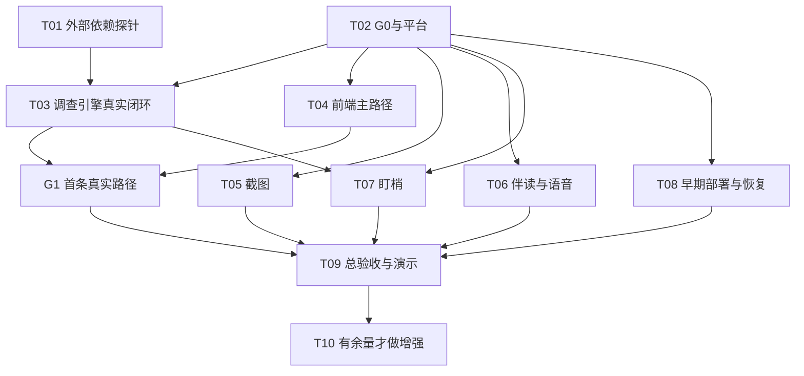

# 侦探 Agent：并行开发任务包

版本v0.2｜2026-10-24｜用户已指示进入开发，G0/T02a已发布，T02b进行中。模块不绑定具体人；实际领取与基准见[第一批派发](协作交接/13-现在开始并行开发.md)。读取任务包不等于自动领取其他模块。

**Goal：** 在PRD范围内交付真实调查、截图、三种呈现、伴读语音、持续盯梢及可核查的验收证据。

**Architecture：** 单仓库TypeScript、常驻API/任务宿主、SQLite持久化。统一证据与结果版本，模块经shared契约连接。

**Tech Stack：** Node 24 LTS（G0锁定24.19.0）、React/Vite、Fastify 5、Zod、better-sqlite3、Vitest、Playwright。确切依赖以G0锁文件和验证报告为准。

**Spec：** [PRD](AI开发需求文档.md)、[系统实施设计](系统实施设计.md)、[实施接口契约](实施接口契约.md)、[验收追踪矩阵](验收追踪矩阵.md)。实现过程可使用本机executing-plans技能；队友缺技能时依本文步骤执行，不依赖主机绝对路径，不自动启动额外子Agent。

队友准备与工具安装范围见[Codex 技能与工具清单](协作交接/12-队友Codex技能与工具清单.md)。其中说明了 executing-plans 的跨技能脚本依赖；未验证完整运行条件时直接按本任务包执行。

## Global Constraints

- 2026-10-25 12:00停新增功能，15:00截止；剩余自然时间不等于工时。
- 元宝是真实核心搜索；三基本模式共享质量，三通用模式只改变呈现。
- 420秒/12次元宝为普通初始预算，重试计入；其他调用也按设计限额。
- 盯梢浏览器关闭仍执行；旧结果正文/引用/伴读不被新结果覆盖。
- 会话隔离；试用与演示预算分开；Key不进入前端、日志、仓库或聊天。
- 截图默认3张；增强项不挤占核心与验证。未经过条件评估和说明不得自行减成1张。
- UI由独立设计交接后唯一前端写入者实施，后端不擅自冻结视觉。

## Review Focus

1. 重复提交/断线/取消重试导致额外费用：T02/T03/T04＋平台竞态测试。
2. 同字段不同含义、旧fixture能过而真实API不匹配：T01/T02/T03＋契约和探针测试。
3. 迟到的worker覆盖取消状态或旧版数据：T02/T07＋epoch与不可变快照测试。
4. 截图归属/否定词丢失、伴读或TTS删掉限定：T05/T06＋真实图/实际听音。
5. 调查API通过而页面、部署或后台生命周期不通：T04/T08/T09＋真实前后端和发布路径。

## 1. 优先级与依赖

P0表示阻塞后续或不先验证会导致大面积返工；P1是必交核心；P2是核心完成后增强，不代表低优先级核心可以删掉。

图中的依赖是实际集成验收的前提。I/E/M可在G0之前读参考、设计样例，不能各自编造公共类型；G0发布后可使用统一受控替身开发，不必等待调查引擎全部完成。

|顺序|任务|优先级|建议执行角色|可交付阶段|
|---|---|---|---|---|
|首先|T01 外部依赖探针 + T02 公共底座|P0|I/E/P各自验证负责的依赖，P统一记录|明确接口可用性与稳定公共基线|
|G0后|T03/T04，T08部署小路径|P0|I、W、P|G1：一条真实输入→结果→来源|
|G0后即可开发，分批接入|T05/T06/T07，T03剩余模式及失败路径|P1|E、M、I|G2：所有PRD核心闭环|
|贯穿各任务，最后集中验收|T09|P0质量门|P汇总，各模块修复|G3：逐项AC证据、试用与演示|
|G3核心通过且有余量|T10|P2|另派短任务|可选增强，不改变核心完成声明|

不把“全部先写完所有后端”作为前端开工条件，也不让未确认视觉阻塞API/部署。主线一旦不可构建或核心回归失败，相关修复优先于新增功能。

## 2. 工作目录、写入权与基线

2026-10-24后续用户明确要求先功能、预留UI并产出独立开发文件：细分派发见[功能并行开发补充包](协作交接/功能并行开发/00-先读与分发.md)。W在视觉确认前只获准写src/web/api、model、controllers与tests/web-model；U仅设计。M可独立领取watch编排，P只负责其存储/宿主适配，I仍拥有compareWatchResult。I/E已派发不另起重复实现；P不新增并行写入者。上述范围优先于旧文档对“全部前端等待设计”的笼统描述，正式页面仍需UI设计交接。

一个仓库。每个并行对话使用独立分支和checkout/worktree，不能在同一目录相互切分支。跨电脑从同一仓库及基准SHA取得代码；不要各自初始化一个项目后再拼目录。

P拥有：`src/shared/`、`src/server/platform/`、`src/server/app.ts`、`migrations/`、根依赖/锁文件/构建/CI/容器。I拥有调查与search/model/reader adapters；E拥有attachments/companion/tts；W拥有web与UI测试；M拥有watch。目录详情见系统设计。

P可以同时承担M，但一次只在自己的工作副本完成一个可验证增量。新增执行者不抢已有目录；先通过交接取得所有权。凡共享字段/包/迁移需要修改，都由P合并小变更后重新发布基线。

G0派发记录必须填真实值：仓库URL、基准SHA、contractVersion、Node/npm版本、操作系统、锁文件、分支、可写目录、实际命令、fixtures、已通/未通API、环境变量名称、成本限制。当前实际值和未验证项见[基线发布记录](runtime/并行基线发布记录.md)，禁止以计划值代替证据。

## 3. 各任务及检查步骤

任务标号T01–T10只在本任务包中表示开发任务；旧研究样例T01/L01等属于caseId，验收文档使用DEV-T01等明确区分。

### T01 / DEV-T01：接口探针和资源阻塞清单

**Owner：** I负责元宝/模型/读取，E负责视觉/TTS，P负责部署与费用登记。P确认接口文件归属后，各人只提交自己的探针。

**Files：** `scripts/probes/search.ts`、`model.ts`、`reader.ts`、`vision.ts`、`tts.ts`、`docs/runtime/provider-readiness.md`；探针依赖T02建立的运行脚本，共享配置由P写。

**Interfaces：** 输入环境变量名称与隔离样例；输出脱敏providerRequestId、字段、时延、usage、探针结果。对应适配器类型来自契约§4，不直接冻结供应商raw对象为公共接口。

- [ ] 核对官方接口、model id、请求体/音色限制；把需要用户登录或开通的项列成具体操作单，不收集明文Key。
- [ ] 在有真实凭据且测试限额已配置后执行最小探针：元宝常规/空结果/过滤、模型结构/错误、读取可访问/失败、三类截图、两个候选音色。
- [ ] 将失败映射成auth/not_enabled/rate_limit等明确类别；确认SDK默认重试是否关闭。
- [ ] 保存`provider-readiness.md`和脱敏报告，报告PASS/FAIL/BLOCKED，未开通一律BLOCKED，不用“你好”成功代替核心字段测试。
- [ ] 提交探针与结论；原始私人截图/凭据不提交。失败时继续可独立完成的受控适配测试。

**验收：** 元宝Pages坏条目可隔离；content未被当正文；真实模型输出可校验；读取限制明确；视觉不混图；TTS有实际音频。任何一项受阻只阻塞对应真实验收，不阻塞全部fixture开发。

### T02 / DEV-T02：G0共同底座与平台

**Owner：** P。分成T02a公共契约可启动、T02b平台行为两个小PR；工作者可在T02a发布后开始受控开发，真实集成等待所需T02b能力。

**Files：** `src/shared/contracts.ts`、`ports.ts`、`fixtures/*.ts`；`src/server/platform/{config,session,repository,budget,gateway,queue,events,snapshots,idempotency}.ts`；`src/server/app.ts`；`migrations/001_initial.sql`；`tests/platform/{contracts,session,budget,idempotency,snapshot,recovery}.test.ts`；根构建与CI。

**Consumes：** 契约草案。**Produces：** 实际Zod类型、InvestigationServices/ExperienceServices、HTTP外壳、统一脚本和fixture；所有签名严格见契约§4。P实现正式snapshot提交和gateway，业务模块仅写checkpoint。

- [x] 建立最小工程与确切依赖锁定；创建五类fixture；为缺失/越界引用、同字段错义、跨会话请求写失败测试。
- [x] 实现schema和契约例子、健康检查与非产品占位页；运行typecheck/test/build，记录实际版本并发布T02a基准SHA。
- [ ] 增加平台失败测试：两个并发预留余额只够一个；同key双POST只建一个run；另会话不能读截图；新结果不改旧payload；旧epoch不能提交。
- [ ] 实现会话、短事务预算/幂等、队列、持久事件、快照、取消及启动恢复；不让HTTP连接控制run生命周期。
- [ ] 在Windows全新checkout和Linux目标执行基线安装/构建及平台测试，修复后发布T02b；缺某平台能力时在派发记录逐项标明。

**关键断言：** `reserved + settled <= poolLimit`；第二个同key返回同runId；取消后gateway新send次数不增加；旧result.payloadHash不变；服务重启不自动重放unknown调用。

### T03 / DEV-T03：调查引擎、三模式和追问

**Owner：** I。

**Files：** `src/server/investigation/{scope,planner,engine,evidence,judge,followup,prompts}.ts`；`src/server/providers/search/yuanbao.ts`、`model/deepseek.ts`、`reader/deepseek-fetch.ts`；`tests/investigation/{planning,evidence,loop,followup,providers}.test.ts`；`tests/evals/cases/`。

**Consumes：** PreparationInput、InvestigationInput/Services、gateway包裹的适配器、checkpoint/events、BudgetSnapshot。**Produces：** `prepareInvestigation`、`runInvestigation`、`routeFollowup`与ResultPayload草稿；不写数据库快照/前端。

- [ ] 按源码D01–D05/D08和研究R01–R05读规定片段，记录采用/拒绝部分；准备一条有明确来源的真实样例与空结果/转载/旧通知夹具。
- [ ] 先写失败测试：query必须有purpose；全部检索失败不递归；转载不多数票；截断材料不能称全文；引用ID失效不能完成；到12次含重试不再send。
- [ ] 实现一条文字查证完整循环与适配器，真实探针可用时运行研究case T01并保存原文支持关系，交第一份小PR。
- [ ] 加入latest/identify策略及反例；复用相同loop，禁止按presentationMode改预算或质量。
- [ ] 实现explain/同案补查/另案路由；验证到限返回需要确认、resume不重置预算、补查只生成新版本。
- [ ] 运行单元/契约测试、固定证据真实模型评测、三种模式真实查询；逐项保存失败和成本，不挑最好一次声称稳定。

**验收：** AC01–04、07–09主要实现；每条核心结论能对应实际材料，技术故障不变成真假结论。调提示词引起的错误加入回归案例。

### T04 / DEV-T04：前端主路径与证据卡

**Owner：** W。UI设计若尚未确认，可先准备状态与受控交互原型，不将候选视觉标为正式定稿。

**Files：** `src/web/{api,router}.ts`；`src/web/pages/{Entry,NewInvestigation,Investigation,Result,History,Watches}.tsx`；`src/web/components/{EvidenceCard,ProgressLog,ClarificationForm,AttachmentInput,UpdateNotice,CompanionPanel,AudioPlayer}.tsx`；`tests/ui/{investigation,history,mobile}.spec.ts`；`docs/ui/design-handoff.md`。

**Consumes：** 公共HTTP契约和五类fixtures，独立UI设计交接。**Produces：** 用户可操作的主路径和明确错误恢复；不定义另一套结果结构。

- [ ] 使用ui-ux-pro-max核查真实状态反馈、错误恢复、触控与阅读层级；记录与PRD冲突的通用建议为何不用。
- [ ] 写核心行为测试：两组模式分别传值；重复开始重用幂等键；重连只GET；partial与insufficient不混淆；旧版提示新报告但正文不变。
- [ ] 完成入口→草稿/上传→澄清→真实进度→结果→证据/复制的可操作路径，先连fixture再接真实API，分别标注证据。
- [ ] 在同一ResultVersion上验证brief/evidence/companion关键结论/限定一致，任务内不另建模式切换功能。
- [ ] 接E/M服务与通知；手机360px、键盘、长中文/多来源/错误状态均实际操作，修复后提交截图/trace与相应AC。

**验收：** AC05/07–10/13–15的可见行为；自动测试不只断言页面打开或按钮存在。

### T05 / DEV-T05：截图输入与提取

**Owner：** E。HTTP上传外壳/私有文件权限由P，W负责界面；先固定附件协议再并行。

**Files：** `src/server/attachments/{validate,extract}.ts`、`tests/experience/attachments.test.ts`、`tests/fixtures/images/`（明确合成，不放私人聊天）。

**Consumes：** ExtractionInput、model服务与私有bytesRef。**Produces：** `extractAttachments`、逐图ExtractionBatch；I消费提取后的命题/歧义。

- [ ] 制作群聊、活动海报、密集文字三类合成图，另有否定词/年份/发言人关键模糊与一图失败样例；写期待的歧义行为。
- [ ] 写上限与归属失败测试：伪扩展名、超大小/像素、三图顺序、跨会话附件、请求总大小。
- [ ] 实现校验及逐图ID明确的视觉提取；将关键不确定送必要澄清，清晰图不机械要求复核全文。
- [ ] 用真实视觉API记录提取差异；与I/W联调“上传→命题→元宝→证据结果”。
- [ ] 提交准确识别与失败记录；若考虑降为1图，必须先证明增量/阻塞、说明影响，不能直接删三图验收。

**验收：** AC06/07/12；OCR或视觉识别分数不渲染成说法真实性。

### T06 / DEV-T06：文字伴读与语音

**Owner：** E，W实现播放器和操作控件。拆文字伴读、TTS两个PR，不等待一次全交。

**Files：** `src/server/companion/{briefing,turns,speech}.ts`、`src/server/providers/tts/tencent.ts`；`tests/experience/{companion,speech}.test.ts`；W另交`tests/ui/companion.spec.ts`。

**Consumes：** ResultVersion、固定persona、交互预算、cursor，统一模型/TTS服务。**Produces：** `buildCompanion`、`answerCompanion`、`synthesizeSegment`；AudioManifest与版本固定的段落。

- [ ] 读取伴读适配及原文相关片段；准备同版冲突/未知/历史更新fixture，写不能升高确定性、错版引用拒绝的测试。
- [ ] 实现3–5短段、自由打断、保存cursor、返回/收尾；新事实请求交共享followup路径，解释不私搜。
- [ ] 测模型坏格式/引用失败一次修复后回退证据卡；文字结果和调查仍可读。
- [ ] 写TTS切段≤150、同cacheKey只生成一次、失败仅补缺块、旧epoch音频不播放的测试；实现服务后交W接播放器。
- [ ] 用已开通的少量音色和真实桌面/手机试听，记录读到限定词、切段/连续点击不叠音、失败保留文字与主线耗时。

**验收：** AC10/15和X01/X11；自动音频字节存在不等于听感通过。

### T07 / DEV-T07：后台盯梢、变化与版本通知

**Owner：** M，可由P承担。

**Files：** `src/server/watch/{scheduler,check,compare,notifications}.ts`；`tests/watch/{scheduler,change,versions}.test.ts`。迁移/仓储新增字段仍由P统一改。

**Consumes：** Watch/WatchCheck、runInvestigation、compareWatchResult、受事务保护的snapshot/notification ports。**Produces：** 到期检查、变化决定和新报告通知。

- [ ] 准备团队可控制的活动页A/B两版、页脚噪声版和抓取失败；记录为合成测试资源。准备开放问题排名变化/同源转载/新公告fixture。
- [ ] 写调度竞态、首次不通知、无变化不通知、失败保留基线、重复变化只一次、A→B→A允许新通知、暂停/删除迟到任务不提交的测试。
- [ ] 实现30秒调度扫描、独占租约、单案件活动锁、周期预算与到期；不能用浏览器timer。
- [ ] 复用调查引擎比较事实变化，事务提交新快照/关联/基线/通知；普通同范围补查时同步watch基线。
- [ ] 用真实读取链路修改受控页并关闭浏览器，等待服务端生成通知；再打开旧报告与旧伴读，核对新旧不混、通知正确指向、再次检查不重复。
- [ ] 追加真实元宝开放问题监测检查，区分召回未更新和未执行；演示加速必须标识，禁止手工插通知。

**验收：** AC11/15；预算暂停/服务中断记录准确，不将失败记为无变化。

### T08 / DEV-T08：早期部署、恢复与运行诊断

**Owner：** P。

**Files：** `Dockerfile`、`compose.yaml`、`.env.example`、`.github/workflows/ci.yml`、`scripts/backup.ts`、`docs/runtime/deploy-runbook.md`；`tests/platform/recovery.test.ts`。

**Consumes：** G0构建、配置、持久目录；真实主机/HTTPS开通后执行。**Produces：** 可追溯部署版本、健康检查、备份恢复说明和运行日志。

- [ ] 根据实际可选资源给出主机用途/报价/期限，用户完成必要开通；无账号时先完成本地Linux容器验证，不称公开部署已完成。
- [ ] 早部署健康检查与持久数据库；验证外部设备及供应商出网，再逐批替换成业务镜像。
- [ ] 测容器重建后历史仍在、服务重启旧run/check标interrupted、不会重放unknown付费调用；真实长任务不受HTTP断开影响。
- [ ] 做一次隔离备份恢复演练；记录WAL一致性、应用/schema兼容性及回退步骤。
- [ ] 发布运行清单：实际commit/image/config/schema、服务结束时刻、预算池、日志路径、可用API、停服入口。生产禁止fake provider。

**验收：** AC08/11–13；本地构建成功不代替部署健康、外网及后台验证。

### T09 / DEV-T09：集成验收、试用与演示

**Owner：** P汇总，各模块修复。用户看实际案例、页面体验和需要产品判断的取舍，不需要人工审每个函数。

**Files：** `tests/evals/runner.ts`、`tests/evals/cases/`、`docs/validation/<release-id>/`、`docs/demo/runbook.md`；私人原始日志不进公开仓库。

**Consumes：** 当前部署commit、AC矩阵、已有25案例、各模块真实/模拟边界。**Produces：** 逐项验收记录、失败回归、真实演示与试用反馈。

- [ ] 对照验收矩阵运行受控回归和真实API评测；保存实际命令/退出码/案例结果、运行时间与费用，不用一个总通过率代替AC逐项。
- [ ] 人工核对三个真实查询的关键来源、条件与未知；检查第二轮确有缺口和新增证据。重要波动案例至少3次小样本尝试，保存所有失败。
- [ ] 实际桌面/手机走核心路径、播放音频；关闭浏览器验证watch，测试历史更新与共享码隔离。
- [ ] 用户邀请试用者或自行试用，记录实际人数与问题；无人试用如实记，不能将合成案例写成用户收益。
- [ ] 修复失败后重跑受影响路径；部署变更后更新证据版本，旧录屏只能作有日期的回放。
- [ ] 整理3分钟建议主线、真实请求与来源证据、已验证盯梢变化、备用录屏和实际提交要求；不存在官方时长确认时不称3分钟为赛事规定。

**验收：** AC01–AC15逐项判定，正式演示不使用假通知或预设答案替代真实调查。

### T10 / DEV-T10：增强项条件任务

仅当核心AC通过、演示预留充足、未到12:00新增功能截止且有可核验余量时进入。可选角色文本自定义、Markdown下载、只读关系图，各单独立短任务和回归；不默认全部执行。

角色只生成可预览文本档案/选预置头像，不在线生图；Markdown导出复用copy所需限定/来源；关系图消费现有claim/evidence/source，不改事实模型、不允许用户编辑证据关系。图前阅读xyflow固定示例与许可证。增强项失败不得破坏核心。

## 4. 统一命令与报告协议

安装/开发/类型/单测/构建/基础E2E及探针命令已建立；eval任务尚未实现。按下表实际状态执行，不照抄不存在的脚本：

|命令|目标|运行时机|
|---|---|---|
|`npm ci`|按唯一锁文件安装|新checkout、锁文件变更|
|`npm run dev`|启动本地前后端|本地联调|
|`npm run typecheck`|公共类型与模块一致|每个相关PR|
|`npm test -- tests/<module>`|Vitest规则、契约与存储测试|模块改动；实际参数必须由T02验证|
|`npm run build`|前后端构建|PR、候选发布|
|`npm run test:e2e -- tests/ui/<case>.spec.ts`|Playwright可见行为|相关PR与合并后|
|`npm run probe`|仅检查配置，不联网|账号配置准备；实测记录另查runtime|
|`npm run probe:search -- --live`|元宝最多1次真实请求，无重试|账号/适配器变化，不由普通CI自动触发|
|`npm run probe:deepseek -- --live`|Fetch1次＋模型1次，上限与报告见脚本|账号/适配器变化，不由普通CI自动触发|
|待实现：`npm run eval -- --suite controlled`|受控案例评测|引擎/prompt变更；目前不可执行|
|待实现：`npm run eval -- --suite live --max-cost-cny <cap>`|真实联网调查评测|正式验收；目前不可执行|

T02允许将不适用的参数形式改为实际工具支持形式，但须同一次提交更新所有任务书/派发记录。任何测试命令以退出码0且预期测试实际执行为通过；0 tests、skip核心场景、受阻、超时不记PASS。

每个任务采用小步循环：写有意义的失败断言→运行确认失败原因→实现→运行相关检查→检查diff→提交小PR。配置/文档等低风险变化只做适当检查，不机械制造镜像测试。每个PR给出对应AC、参考位置、已执行命令与结果、报告、费用、未测/风险和接口变更。

## 5. 分发给新对话的提示词

先在总集成对话采纳方案并完成G0。下列模板中的实际仓库/基线/角色信息由P填，不让接收方猜。模板属于供用户未来使用的指令，本轮不会发送给任何对话或队友。

### 总集成对话

> 负责侦探Agent的总集成。先读PRD v1.0、系统实施设计、实施接口契约、并行任务包、验收追踪矩阵及相关参考。核对本对话得到的编码授权和实际工作区；没有授权先报告当前状态。按用户已采纳版本执行T02和T08，统筹T01，建立真实G0和派发记录。你独占shared/根依赖/迁移/平台与合并。不要要求用户决定常规函数细节；遇购买、范围变化或无法消除的阻塞，给出证据和具体选项。所有完成声明附当前版本验证，未测保持未测。产品代码不因读到本模板自动开始。

### 模块对话

> 你负责【模块角色＋任务编号】。仓库【真实URL】，基准【真实SHA】，contractVersion【实测版本】，分支【分配分支】，可写目录【目录】。先读PRD、系统设计、公共契约、你的任务及验收矩阵，再按任务要求读取研究和固定源码。检查工作区与依赖是否真的就绪。只改拥有目录；共享字段/依赖/迁移向P提变更。按可验证增量交付；先受控测试再按授权预算做真实接口验证。保留当前状态、测试证据和未提交内容，阻塞时用交接模板，不猜他人的接口、不标假通过。此启动指令由用户在确认进入编码阶段后发出。

### 审查/接续对话

> 审查或接续【任务/PR】。以当前commit、PRD、契约和对应AC为准，读取实际diff与测试，不依赖前一Agent的完成总结。重点检查字段语义、所有权、预算/重试、快照、取消迟到和真实/模拟边界。输出可复现问题、证据和最小修复建议；接续前核对分支与未提交改动。未经用户授权不要向其他聊天或人发送消息。

## 6. 阻塞与交接

沿用[派发与阻塞模板](协作交接/11-派发记录与阻塞模板.md)，把人名替换为角色。包含目标、基准SHA、contractVersion、已保存成果、准确脱敏错误、复现命令、尝试结果、谁需做什么、可继续独立工作、费用/未知调用。阶段完成或上下文需要接续时写文件并提交；新的聊天不能靠旧聊天“记住”。

如果用户暂时只有一个可用对话，按T02→T03最小闭环→T04→T05/T06/T07依次执行，T01/T08尽早穿插；任务契约不变。如果有多个对话，按图中的已满足依赖分配，不能用同时开始替代G0。

## 7. 文档状态

本任务包描述未来实现与检查，没有运行其中任何产品命令。文档采纳、G0发布、模块自测、集成通过、真实API通过、部署通过、用户试用、演示完成分别记状态，不合并成一句“完成”。
