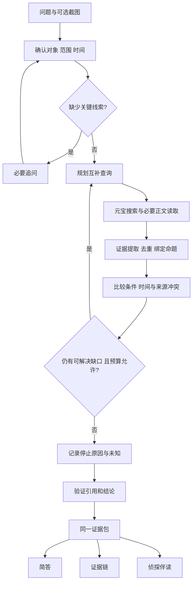

# 侦探 Agent：九个方向的深入调研参考

日期：2026-10-24。读者：用户验收研究，以及后续编写 PRD、实现代码的 AI。

**结论：三个基本模式可以共用调查引擎，值得全部保留；但可靠性不能只靠三份 system prompt。** 查询规则可以在提示词中，来源身份、证据对应关系、时间、预算、错误状态和最终引用必须由结构化数据与程序约束。最值得复用的是成熟项目里经过具体实现的机制，而不是把一个大研究框架整体搬来。

本文是**研究完成后的建议稿，不是批准实施的 PRD**。已查官方资料、固定版本源码和相应测试；未调用付费元宝／模型 API，未运行这些项目或做中文效果基准。已知事实、工程推断和待实测项分开写。

## 阅读与验收入口

- 本文：九方向覆盖、适配方案、取舍。
- [开源项目源码审查](开源项目源码审查.md)：9 个项目逐项说明凭什么参考、看了哪段实现、哪些必须舍弃；附 commit 和许可证。
- [API、成本与部署核查](API与成本核查.md)：当前元宝／视觉／阅读／语音接口，300 元预算模型和集成验证门槛。
- [调研验收样例](调研验收样例.md)：三个基本模式的演示候选、失败与跨模式样例、待运行验收表。
- [赛道理解](赛道理解.md)、[需求澄清记录](需求澄清记录.md)：官方要求与用户决定的真源。
- [源码 manifest](research/source-manifest.json)、[仓库状态快照](research/repositories.json)：便于 AI 定位依据，不必重新凭印象猜实现。

### 九方向覆盖矩阵

把用户关于“三种通用模式”的研究拆成证据呈现与伴读两项，因此共 9 项，没有合并掉内容。

| ID | 用户要求 | 主要依据 | 本文输出 | 验收入口 |
|---|---|---|---|---|
| R01 | 拆分、衍生、搜什么、搜几次 | P01 / P02 / P03 / P05 | 查询任务、角度选择、调用预算 | T04、L03、X07 |
| R02 | 分类分层、交叉核对、产生新方向 | P02 / P04 / P05 | 资料层级、去重、证据提取、缺口 | T02、X02、X03 |
| R03 | 不确定、追问、有用答案、来源规范 | P03 / P05反例 / P08 | 证据状态、引用规则、失败与下一步 | T04、X01、X06、X08 |
| R04 | 多步调查、冲突、汇总循环 | P01 / P02 / P06反例 | 状态流、冲突比较、结束条件 | T02、L02、X05、X07 |
| R05 | 查真假／查最新／查模糊定制规则 | 前述机制＋官方实例 | 三套判定目标与共通约束 | T01–T04、L01–L03、F01–F03 |
| R06 | 截图提取并转成搜索 | P07＋DeepSeek视觉官方接口 | 视觉与OCR比较、提取结构、边界 | X04、X09 |
| R07 | 简答、完整可视化证据链 | P04 / P08 / P09 | 同一证据包、卡片／图比较、追溯 | X01、X02、X10 |
| R08 | Socratopia式侦探伴读与朗读对话 | 官网、用户截图、MDN、腾讯TTS | 角色、分段、追问、TTS实现取舍 | X01、X11 |
| R09 | 持续盯梢 | P06＋元宝适配 | 固定目标／开放问题两种设计、去重和告警 | M01–M04 |

P01–P09 详见源码审查文档。表中的 T/L/F/X/M 是验收样例编号，不是声称测试已通过。

## 研究边界与选型原则

已确认目标：网站、赛道前三、元宝核心检索、10 月 25 日 15:00 前开发完成、总预算 300 元。保留三基本模式；三通用模式调查质量相同。复杂查询可花 3–5 分钟或更长。固定侦探文字伴读＋点击朗读已确认；证据链卡片或图尚待讨论。

入选理由必须同时说清：问题相关、可定位实现、实际迁移成本。stars 只作辅助。已归档项目可以学机制，但不包装成活跃依赖。没有合适成熟项目的地方直接说明缺口。研究期间没有发现可以原封不动解决全部要求的仓库。

## R01：如何决定搜什么、搜多少次

**依据：** GPT Researcher 把 query 和 researchGoal 绑定并按深度拓展；STORM 用资料导向的多视角提问；Jina 根据第一批结果改写查询并去重。具体源码在 P02、P03、P05。Jina 的用户潜意识推断和固定七个视角不适合本产品。

### 建议采用的查询规划

先形成一个可修改的调查说明：

- 用户原问题、主要基本模式、对象与别名。
- 待核验命题／待确认当前状态／候选识别目标。
- 地域、版本、时间范围；用户“明天”的参照时间。
- 已知线索、缺失关键项、何种证据能改变结论。
- 允许的调用与时间预算。

每条查询保存 `query、purpose、claimIds、expectedSourceType、timeScope、origin`。purpose 用清楚的话，例如“寻找主办方原始通知”“检查是否发布延期公告”，不保存或展示模型内部思维过程。

| 策略 | 适用情况 | 不宜滥用的情况 |
|---|---|---|
| 原句／关键短语检索 | 找传播源、公告、原始表述 | 截图含私人姓名和无关聊天时应只取必要内容 |
| 拆原子问题 | 一个问题含截止、资格、费用等多个可独立核验事项 | 不要把简单实体识别拆成十几个任务 |
| 实体／别名扩展 | 简称、译名、旧称、错记名称 | 扩展项必须标为候选，不能写回为已确认事实 |
| 原始来源定向 | 官网、作者原论文、产品文档 | 官方只对其自身事项有相应证明力，不代表全部客观争论终局 |
| 反证／例外检索 | 强断言、真假争议、可能存在条件 | 不能为了“平衡”制造不存在的反对意见 |
| 时间更新检索 | 当前状态、延期、版本变化 | 最新发表不自动是最新事件 |
| 相邻候选／区分线索 | 模糊影视、软件、游戏名称 | 优先能区分候选的线索，不无限加同义词 |
| 外语原词检索 | 原始材料主要非中文 | 不因为有能力就每题多语言展开 |

**程序与 AI 分工：** AI 建议下一条最有价值的查询；程序检查是否重复、是否符合预算、是否仍在范围内。只在有证据缺口时追加；已搜过但失败的请求按错误类型处理，不伪装成新角度。

### 可实测的初始控制值【建议，不是行业最优值】

第一批 2–3 条互补查询；后续每轮 1–3 条。普通调查暂以 **12 次元宝调用、最多 4 个调查批次、6 次正文读取、并发 2** 为硬上限候选；其中包含重试，不另外偷偷增加。期限先试 300 秒软提醒、420 秒硬截止，部署必须支持。达上限保留部分结果；用户主动继续才开新预算。简单问题证据已够时应提前结束，不用满配额。

这些数值为控制工程和费用的实验起点，最终按真实样例的新增证据量、延迟和成本调整。用户选“简答”时仍遵守同一标准；不能少搜来换简短。

## R02：如何处理带回来的内容

**依据：** P02 保留发现和来源，P04 有来源聚合，P05 约束搜索后阅读；P08 检查证据支持关系。元宝返回的 passage/content 是摘要字段，不能把字段名 content 当作完整网页正文，见 API 核查。

### 三层资料结构【工程建议】

1. **线索层**：搜索命中，保存 title、URL、摘要、搜索日期、queryId。仅证明“搜索系统返回过这些内容”。
2. **证据层**：实际读取内容中的短片段，绑定 sourceId、原文位置、获取时间、读取范围。保存“原页全文／部分正文／仅搜索摘要／用户截图”类型。
3. **判断层**：某条证据支持、反驳、补充条件或无法判断某命题；判断依据和未解决问题独立保存。

关键判断优先读原始页面。打不开时保留摘要作为线索并标明读取限制，可以寻找同一机构其他页面、原始文件或请用户提供原文。不能把另一个转载补位后仍称“已读原始来源”。

### 资料进入上下文前的处理顺序

- 规范化 URL（保留影响内容的参数），按 URL 合并重复命中。
- 再看作者、原始出处、引文、相同段落，标注转载关联；不把三个域名必然当三份独立证据。
- 提取与命题相关的片段，保留数字、否定词、日期、范围和例外；摘要不能丢掉 sourceId。
- 给来源标角色：一手声明、独立报道、转载、商业推广、论坛经验、未知。它们是角色，不是自动真假标签。
- 建立“命题 × 证据”表，找覆盖不到的部分和真正冲突。
- 下一轮搜索由缺口驱动，例如“现有材料只有宣传；找测试条件”，而不是机械增加网站数。

**不建议第一版引入向量数据库。** 单次十几条查询的材料可用结构化数组和证据片段处理。只有实际上下文量／检索失败证明需要时再增加 embedding、reranker。此为本项目规模下的工程判断，不是说这些技术无价值。

**尚不能证明：** 多站点抓取、模型二次自检或去重本身能降低多少幻觉。应从验收中观测错引、遗漏、重复转载和条件丢失，不能套用其他项目宣传的准确率。

## R03：怎样诚实而有用地回答

**依据：** 赛道明确“不知道不扣分，瞎编才扣分”；STORM 有基于资料无法回答的出口；ALCE 分别检查引用覆盖与支持。Jina 的 definitive 评估是反面例子，不采用其“越肯定越合格”的目标。

这里应优先的是**确定性与证据相称**，不是让文风更肯定，也不是每句话都加“可能”。

### 统一的证据状态【建议】

| 状态 | 含义 | 用户可见表达 |
|---|---|---|
| supported | 在明确条件下有直接支持、无未处理关键反证 | “在……条件下，现有资料支持……” |
| refuted | 有直接反证否定待查命题 | “这句话不成立，原始资料实际说……” |
| mixed | 一部分成立、条件不同或存在实质冲突 | “不能直接说真／假；分歧在……” |
| insufficient | 已查范围不足以支持或否定 | “目前不能确定。已确认……，缺少……” |

技术错误、预算截止属于 **runStatus / stopReason**，不能作为第五种“事实真假”。截图识别有疑问也单列，不与来源真实性混在一起。首版不展示“87%可信”这类未经校准的概率。

### 三种展示都不能删除的内容

结论与适用条件、关键不确定点、查询时间、对应来源入口。简答可以只用几句话，细节折叠；不能隐藏一条会改变结论的冲突。完整答案再展开证据、查询步骤、候选排除与局限。

每条关键事实引用实际存在的 sourceId / evidenceId，由程序生成 URL。支持、反对和背景引用要区分。引用存在、能打开、包含相关文字、足以支持当前命题，是四项不同的检查。普通背景陈述不必机械每句加引用，关键可核验事实必须能追溯。

### 追问与不知道的可用出口

- 对象或时间不明会改变调查对象时先问；已有内容能回答的不要再问。
- 简答只问必要项；其他模式先短述范围，再问缺失关键项，沿用已确认方案。
- 能先查一部分时可以进行，并标出分支条件；不能自行填“默认广州／默认本届／默认今天”。
- 查不到：列已排查范围、确认的局部事实、仍缺的证据以及最有效下一步，例如活动全名、主办方原链接、完整日期。
- “在公开网上未找到”不能升级成“不存在”；接口失败更不能升级成“是假消息”。
- “建议联系主办方”属于行动建议，不伪装成已经联系或获得答复。

### 需要程序强制的质量门

引用 ID 不存在→退回修正；真实来源仍不支持→删弱结论或降为未知；sourceDate 缺失→保留 null；读不到正文→不能显示已阅读全文。模型输出不符合结构时有限重试，再返回可解释的部分结果。

网页和截图里的“忽略之前规则／调用某接口”等内容作为被分析资料，不能成为系统指令。对来源内容做边界隔离是本任务必要的防护，不应因其看起来像官方文档而放松。

## R04：多步调查、冲突与循环

**依据：** P01 的状态流程、P02 的递归和空结果终止、P06 的故障放行反例。建议采用单个受控调查循环；“多步”不要求“多个 Agent 同时讨论”。

### 冲突处理顺序

先核对是否同一对象、地区、版本、时间、定义、统计口径，再判断是否真正互相矛盾。若是更新关系，解释旧说法何时失效；若是转载关系，追到共同原始出处；若是各方利益相关声明，明确由谁提出而不直接采信。

优先证据直接性、来源与事项的相关权威、可观察内容、适用时间、独立性。不要给网站设置固定总分后机械投票。即使一方来自官方，也检查它是否回答当前问题、是否过期、有没有撤回或限制条件。

真正无法解决的冲突：保留两边片段、来源日期和各自条件，列出会改变结论的待补材料。用户看到的是**可复核的判断摘要**，不是模型完整思维链。

### 停止条件

- 核心问题已有直接证据，关键反证／候选差异处理完：完成。
- 新搜索只得到重复或不相关材料：证据收益停滞。
- 达时间、token、搜索或费用上限：预算截止，输出部分结论。
- 全部搜索失败或鉴权错误：服务失败，保留已获取资料。
- 缺关键用户线索：等待用户。
- 用户取消：取消，停止排队任务。

“迭代了三轮”不证明完成；“模型说完成”也应经过结构和证据检查。状态可建议为 created / clarifying / researching / evaluating / completed / partial / failed / cancelled；具体 API 字段待 PRD 决定。

## R05：三个基本模式怎么复用，又怎么不同

没有找到一个经过本轮核实的成熟开源项目，直接提供适合我们的完整三分类裁决规范。以下是从已有实现、赛道目标和官方案例综合出的**本项目规则建议**，不假称某仓库已验证。

| 项目 | 查真假 | 查最新 | 查模糊 |
|---|---|---|---|
| 基本单位 | 可核验的原子命题 | 对象在某个时刻的状态 | 候选及辨认线索 |
| 先确认 | 主体、断言、条件、版本 | 地区、对象、查询时刻、有效期 | 记得的线索哪些确定、哪些可能错 |
| 搜索重点 | 原出处、直接支持、反证和例外 | 当前官方页、更新／撤回记录、时区 | 候选生成、别名、最能区分的线索 |
| 最易犯错 | 没证据就判假；条件性事实绝对化 | 把发文新当事件新；旧截图当实时状态 | 先猜一个名字，再只找支持它的结果 |
| 输出核心 | 命题、判定、适用条件、反证 | 截至何时、状态、发布日期／事件时间 | 候选、匹配项、不匹配项、下一问 |
| 成功结束 | 证据足以处理核心断言 | 能说明当前已知状态及时间限制 | 唯一候选有区分依据，或诚实保留多个 |
| 无法结束 | 缺原文、关键事实冲突 | 最新可用资料仍旧／页面不更新 | 候选都不充分／只有共性线索 |

### 三个容易误做的具体规则

**真假与最新交叉：** 用户选择查真假后问“群里说活动明天截止是真的吗”，仍执行日期、届次和延期检查。不需要自动切到另一模式。截图的“明天”要参照截图消息日期，不能参照今天。

**最新的时间字段：** queriedAt、sourcePublishedAt、eventAt／effectiveAt、fetchedAt 分开保存。无法提取就未知；时间窗口过滤只帮助检索，不证明事件新。即使是刚抓到的页面也可能没有更新。

**模糊的候选保留：** 优先保留少量有实际来源的候选，并列 matchedClues / conflictingClues / missingClues。下一问选最能区分候选的一项，例如主角年龄或乐器。不要给未实证的匹配百分比。用户记错一条线索时保留说明，不轻易排掉最可能候选。

实现增量主要是 schema 中目标类型、不同规划与评价规则、不同展示字段和验收样例；调查调度、来源库、预算、读取、引用可复用。因此保留三个模式合理，但“只增加两份 prompt，完全不增加验收”不成立。

## R06：截图查证

### 方案比较

| 方案 | 收益 | 成本／不足 | 本项目判断 |
|---|---|---|---|
| 视觉模型一次提取 | 能结合布局、对话角色和图片上下文；已有候选 API | 小字、否定词、日期可能识错；结果非确定事实 | 优先做小样本验证 |
| OCR 后交文字模型 | 文字框和识别信息便于定位；密集字可单独处理 | 要加OCR依赖；布局、图表语义仍需理解 | 低清／密集文字的后备 |
| 视觉＋OCR双跑 | 可定位差异 | 两套服务仍可能共同犯错，增加成本与流程 | 只对关键数字等失败案例升级 |
| 反向搜图／取证 | 可查图片出处或编辑线索 | 额外服务与不同技术问题 | 不宣称首版已覆盖 |

DeepSeek 官方目前确认 `deepseek-flash` 可接图。大图进入模型前仍会缩放，因此“用 original”不等于超长图每个小字都会保留。[视觉文档](https://api-docs.deepseek.com/zh-cn/guides/vision/)；P07 作为 OCR 后备依据。没有实测前不能说哪一种准确率更高。

### 建议流程

1. 校验图片类型、尺寸；显示原图供用户核对。
2. 提取关键原文、发言角色／来源线索、日期、实体、主张、看不清区域。对无法辨认的字标 unknown，不能补全。
3. 形成待查命题，明确“图片声称……”与“现实是否如此”分开。
4. 若一个不清晰数字或日期会改变结论，先让用户确认或提供更清晰局部；不强制每张图确认整段 OCR。
5. 以最少必要文字进入共用调查流程。必要时对长图分区保留顺序和重叠，不把模型猜测的框当精确 OCR 坐标。
6. 最终展示提取内容、已核实事项、未核实事项和原始来源。

**文字转搜索结构建议：** imageId、extractedText、claims、entities、visibleDates、ambiguousSpans、sourceHints、cropRefs。sourceHints 只能是线索，头像／logo／水印不能独自证明来源官方。

图表多一步：读轴、单位、时间范围、图例、基数与截断；只查能辨清的主张。不清晰时请用户提供表格或原报告。截图内容真实不代表截图未经编辑；查证命题不等于鉴定图片真伪。

## R07：简答与完整可视化证据链

**依据：** Vane 可借鉴来源组件和过程事件，React Flow 可借鉴节点连线交互，ALCE 提醒引用要关联主张。没有证据支持“图必然更可信”或“卡片一定更省用户时间”；UI 选择留给下一轮 Grill-me。

### 共同数据，分别呈现

同一个 InvestigationResult 提供结论、命题、证据、来源、候选、冲突、缺口、操作记录、查询时间。三种通用模式均从它生成，不分别重新研究，不因简答压缩而丢失限制条件。

| 形式 | 适合 | 真正要做的事 | 不解决的问题 |
|---|---|---|---|
| 简答 | 快速得到可行动结论 | 结论＋关键限定＋来源入口，详细证据折叠 | 不能靠删未知／少搜索变快 |
| 分层证据卡／时间线 | 逐条阅读和手机使用 | 命题→支持／反对片段→原来源；过程记录另列 | 多对多关系可能较难一眼看全 |
| 只读关系图 | 展示候选排除、证据冲突、多对多支持 | 稳定ID、明确边类型、布局、点击侧栏、筛选、移动端退化 | 连线本身不证明证据支持 |
| 图＋卡片 | 图看结构、卡片读原文 | 两个视图共用数据；额外交互与适配 | 工程量最高，不默认首版做全 |

建议证据链表达 **问题→命题／候选→证据→来源→结论**；边含 supports / contradicts / qualifies / derived_from。调查日志“搜索了什么”单列，不能与“为什么相信”混成一条流水账。

完整性不是把每个 token、每条垃圾搜索结果全画出来，而是关键结论均可追到资料，未解决冲突不被隐藏。无证据的节点必须明确空缺，不能画虚构证据节点撑版面。

**工程估计只作比较：** 卡片低、只读小图中、可编辑大图和双视图高。尚未建 UI 原型或计时，不能给出可靠的开发小时数。建议后续在同一多来源案例上对比“用户能否找到反证、定位原文”，再定形态。

## R08：Socratopia 伴读专项

### 已核实的体验与证据边界

用户提供的两张体验参考图已原样保存：[伴读界面](research/用户参考图/Socratopia-伴读.png)、[伙伴与节奏选择](research/用户参考图/Socratopia-选择伙伴.png)。它们用于分析交互，不作为产品素材授权或后端实现证据。

官网用角色、逐步问答和场景组织学习；用户两张截图可见固定伙伴头像、动作叙述、音色与节奏选择、单条朗读入口。官方 FAQ 描述输入可用设备听写，回答由伙伴语音读出，不能因此推断它使用实时双向语音技术。[理念](https://www.socratopia.app/zh/method)、[FAQ](https://www.socratopia.app/zh/faq)。

本轮没有核实到官方原版开源仓库；不把非官方复刻当成熟实现。官网对学习效果的宣传不是本产品效果证据。只借鉴可观察的交互，不照抄角色素材、台词或品牌。

### 适合侦探产品的迁移【建议】

**后续补查（Q21）**：额外读取官方[线性代数课堂PDF](https://www.socratopia.app/sample-lessons/linear-algebra-theo-zh.pdf)。前几轮能直接观察到“提出问题—用户作答—针对回答反馈—转换角度继续问”的交互，角色动作穿插其间。因此，借鉴其伴读不能只化约成固定卡片＋下一页。可采用基于同一证据包的自适应讲解，让用户自由追问／表示继续，侦探按回应选择下一证据或解释；无需强制每轮答题。该迁移仍待Q21确认，不能写成定稿。官方样例说明形式，不证明教学或事实准确性；本项目证据约束仍独立验收。

- 一个固定侦探，少量动作和稳定口吻；角色可以说“这两条报道来自同一个原始公告”，不演出没有证据的破案结论。
- 结论始终可直接查看；用户自愿进入按证据节点伴读。
- 每段围绕一个证据点，保留 sourceId 和 evidenceId，提供“看原文”“为什么不采信”“下一条”“追查这个疑点”。
- 追问若只要求解释，基于当前证据回答；超出材料或涉及最新状态，进入受预算约束的补查并显示正在补查。
- 朗读的是已核验的正文，限定词必须读出来；URL 不逐字符朗读，改读来源简称与编号，文字链接仍保留。
- 剧情动作不携带事实性新信息，不让角色自信语气覆盖 uncertain 状态。

### 朗读技术选择

| 路线 | 成本与优点 | 限制 | 顺序建议 |
|---|---|---|---|
| 浏览器 SpeechSynthesis | 无本项目云TTS请求费，接口少 | 中文声音、质量和设备差异；不能保证全部本地处理 | 先在演示和试用设备验证 |
| 腾讯云通用TTS | 可以稳定指定所选音色 | 需密钥、代理、音频缓存与失败处理 | 设备声音不达标时的候选 |
| 自托管语音模型 | 控制更大 | 部署、算力、模型素材授权与性能工作 | 本期限内不推荐 |
| 实时双向语音 | 更像通话 | ASR、打断、会话同步、音频状态增多 | 已不作为第一版目标 |

[MDN SpeechSynthesis](https://developer.mozilla.org/en-US/docs/Web/API/SpeechSynthesis) 给出声音列表、播放／停止／暂停和队列操作；[腾讯 TTS 计费](https://cloud.tencent.com/document/product/1073/34112) 提供付费后备。没有为了凑开源项目再引入一套大型语音 Agent；当前需求用标准接口更直接。

**优先顺序：** 固定角色和文本解释 → 按段点读＋停止 → 有依据的追问 → 节奏／语气细化。多角色选择、世界观、养成、3D、自动剧情分支暂不列入实施建议。

## R09：持续盯梢

“定时跑一次”是容易部分，可信变化与持续执行是主要工作。站内提醒减少通知渠道工程，但不免除后台调度、持久化和防重复。

### 两种盯梢不能混为一谈

| 项目 | 固定对象／页面 | 开放问题／新证据 |
|---|---|---|
| 输入 | URL＋关注字段／条件 | 问题＋范围＋触发条件 |
| 核心检测 | 获取关注区，比较规范化前后内容 | 按计划重新元宝搜索，读候选新材料 |
| 基线 | 字段值、有效日期、内容hash | 已知证据集合、来源指纹、当前结论版本 |
| 触发 | 有意义字段改变，经核验符合条件 | 新证据足以改变结论／解决缺口／引入重要冲突 |
| 常见误报 | 导航、广告、时间戳变了 | 排名变了、旧闻被重新发现、转载重复 |
| 参考 | P06 直接相关 | P06 的状态思想＋本项目调查循环 |
| 成本 | 每次抓取，必要时模型核验 | 每次可能多轮搜索与模型，须额外预算 |

开放问题如“某产品正式开放报名了吗”，应尽量先定位主办方权威页面，将后续大部分检查收敛到固定对象，但保留有限的补搜路径。不能未经用户同意把“全网消息”悄悄缩成只查一个 URL。

### 最小可靠闭环【建议】

watch 保存关注对象、条件、频率、状态、下次检查时间和已核验基线。独立任务读取旧基线并获取新材料；比较后生成变化记录；通过核验才更新“已确认状态”。通知以 watchId＋变化版本做幂等键。

第一次检查建立基线，不发“变化了”。相同内容不重复提醒；改变监测范围时重建基线并说明。抓取失败不覆盖旧内容为空；模型失败可记“发现待核验变化”，不能显示“已确认达标”。页面登录／反爬导致无法读取应显示限制，不承诺永久监测。

用户离开浏览器后仍要执行：浏览器定时器不够。若只提供“回来时重新查”，需如实命名，不能算持续盯梢。站内通知写入数据库，用户回来显示未读。

**规模建议待确认：** 默认每小时、每用户少量 watch、每项到期时间；手动“立即检查”走同一队列和限额。比赛演示可对标明的测试页面短间隔检查，以验证真实变化→任务→通知，不能伪装成随机外部新闻自然变化。公开问题的自动任务不能无限续费。

## 跨方向的结构化证据包【给 AI 的设计参考，非最终接口】

| 对象 | 最小建议字段 | 为什么需要 |
|---|---|---|
| Investigation | id、question、basicMode、presentationMode、scope、queriedAt、status、stopReason、budget | 区分模式和执行边界 |
| SearchTask | id、query、purpose、claimIds、round、requestId、status、cost | 查得出为什么搜、真实调用多少 |
| Source | id、url、title、publisher、publishedAt、fetchedAt、contentType、readStatus、originGroup | 保留来源与读取限制 |
| Evidence | id、sourceId、excerpt、locator、claimIds、relation、extractionLimit | 引用绑定实际内容 |
| Claim | id、text、conditions、status、evidenceIds、conflicts、unknowns | 避免整篇一个真假标签 |
| Candidate | id、name、sourceIds、matchedClues、conflictingClues、missingClues | 模糊模式保留竞争答案 |
| Result | answerBlocks、citations、claimIds、nextSteps、limitations、version | 三通用模式共享 |
| Watch | id、target、condition、baselineVersion、nextRunAt、expiresAt、status | 真正持续执行 |
| ChangeNotice | watchId、beforeVersion、afterVersion、status、evidenceIds、dedupeKey、readAt | 区分变化、核验与提醒 |

没有 sourceId 的事实性证据禁止落入已确认结果。源文本与模型解释分栏。修改裁决时增加结果版本，而不是悄悄覆盖用户已看过的结论。

## 面向截止时间的取舍建议

**保留核心：** 三个基本模式、一条调查引擎、结构化引用、未知／冲突出口、必要追问、真实元宝调用记录。前端展示形式不改变质量。

**优先做成可演示差异：** 一个确实需要第二轮搜索的案例；一处来源冲突讲清楚；截图提取进入同一调查；用户能点击证据确认。固定角色文字伴读是轻量呈现层，朗读在目标设备实测后加入。

**需要下一轮决定的两项：** 证据链用卡片、只读图还是有限混合；两类盯梢是否均做薄实现，还是先固定目标＋开放问题的明确降级。本文已研究两类，没有替用户砍掉。

**暂不推荐：** 多 Agent 团队、大型向量库、自托管OCR／语音模型、图编辑器、多个角色养成、实时双向语音。原因是实现与验收工作增加，未证明对本次目标必要。

## 与赛道要求再核对

| 赛道要求／关注 | 研究如何落实 | 仍需真实材料 |
|---|---|---|
| 元宝核心、作品可用 | 真实搜索适配＋可访问后端 | 实际请求、可打开网址 |
| 3次真实查询、可点击来源 | 样例文档指定三候选，引用检查 | 用成品实际运行并录制 |
| 准确、敢于不知道 | R03 状态、失败出口 | 不确定／缺信息案例实测 |
| 多步、交叉核对、冲突解释 | R01–R05、来源关系 | 第二轮查询和冲突证据 |
| 有吸引力、容易体验 | R07–R08、直接结论与伴读 | 首次用户反馈 |
| 深度调查报告 | 证据包导出为报告 | 实际调查输出 |
| 截图查证 | R06 完整闭环 | 输入→提取→查询→来源录屏 |
| 持续盯梢 | R09 真实变化与幂等通知 | 前后快照和真实执行记录 |
| 真实用户 | 样例不能冒充真实用户 | 找队友／现场用户实际提问 |

官方没有提供精确分值；这里不虚构权重。架构复杂和 UI 炫酷不自动加分。

## 调研的局限与下一阶段

已完成：9 方向覆盖、9 项目筛选与定向源码审查、官方接口／费用核查、截图与伴读的替代路线、两种盯梢设计、可验收样例。元宝公众号限制、API时间参数变化、Jina肯定性偏好等具体发现已反映到建议中。

未完成且不能冒称完成：付费 API 兼容实测、截图识别准确率、中文检索召回、网页抓取成功率、声线试听、部署网络可达性、成本实测、真实用户试用。它们应成为随后开发的最小探针和验收，不是继续搜更多仓库就能证明的事实。

**用户验收本研究后，再继续 Grill-me 定 PRD。** PRD 应冻结行为、数据契约、状态转换、失败规则、预算、优先级及验收案例，避免 AI 开发时把本篇“候选建议”全部自动实现。

