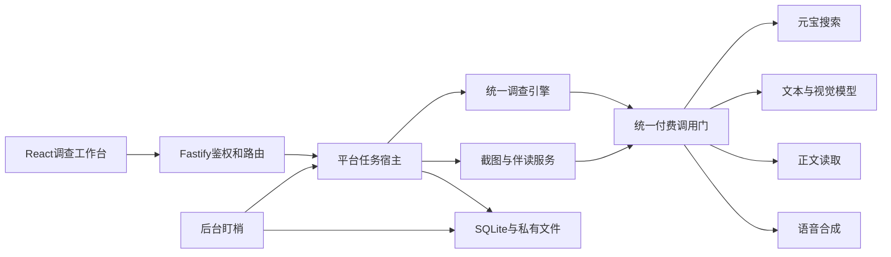

# 侦探 Agent：系统实施设计

版本：v0.1｜2026-10-24｜依据 PRD v1.0。用户已指示推进 G0 实施；运行状态和技术决定见 docs/runtime，尚无真实付费联调或完整产品验收。

## 1. 目的、真源与使用方式

目标是让用户的多个开发对话或队友 Agent 按同一组边界实施，而不是各自解释需求。执行者不绑定人名；开发并行不等于产品内部需要多 Agent 框架。

阅读顺序：

1. [PRD](AI开发需求文档.md)：产品范围、用户行为、AC01–AC15。
2. 本文：实现机制、依赖、预算、运行和参考取舍。
3. [实施接口契约](实施接口契约.md)：跨模块数据、函数与 HTTP 约定。
4. [并行开发任务包](并行开发任务包.md)：各对话的写入范围、前置条件、步骤与交付。
5. [验收追踪矩阵](验收追踪矩阵.md)：测试、真实评测及发布证据。

用户最新决定 > PRD与确认记录 > 经采纳的实施版本 > 研究建议。本文是补齐现有[协作总计划](协作交接/00-并行开发总计划.md)的技术草案；不得因读取草案自动开工。正式编码前由总集成对话核对用户是否采纳，并发布实际 G0 基线、契约版本与测试命令。现有按人待办是转交辅助，不限制用户自行多对话承担模块。

以下默认数值是可调工程起点，调整须记录原因和实测；不把它们写成用户逐项批准或行业最优。2026-10-25 12:00停新增功能、15:00截止的约束不变；2026-10-24约15:32核对时，距停新增功能约20小时28分，不能将其视作可连续工作的工时。

## 2. 技术路线与替代方案

沿用现有方案：TypeScript、React + Vite、Fastify 5、Zod、SQLite + better-sqlite3、npm；Vitest、Fastify inject与Playwright。一个常驻Node服务提供静态前端、API、有限后台队列和调度器；一个持久卷保存数据库、附件与音频缓存。

|选择|理由|代价、替代与验证|
|---|---|---|
|Node 24 LTS，G0锁定24.19.0|新项目无旧版运行兼容负担；与本机现有环境一致，减少双运行时维护|2026-10-24用户询问后复核：Vite、Vitest、Fastify、SQLite依赖允许24，SQLite实际读写通过；完整构建和测试结果以G0报告为准。取代此前Node 22候选|
|React/Vite + Fastify同源|工作台无需优先SSR；浏览器与API共享类型；生产同源简化cookie|比全栈框架多一个开发代理；G0同时验证Windows开发与Linux构建|
|SQLite单实例|事务可同时保护额度、状态和通知；免额外数据库服务|只部署一个写入服务实例；短事务；原生依赖与持久盘必须验证。需多副本时另立设计，不直接扩容|
|程序编排的受控调查循环|预算、退出、状态和事实约束可直接检查|模型负责建议查询/证据判断，程序负责授权执行；不引入LangGraph等全套框架，不是声称它们无价值|
|前端增量轮询|已有事件序号可重连；避免将任务寿命绑到HTTP连接|活跃页面2秒轮询，隐藏页面15秒或暂停，恢复立即拉取；服务器仍独立运行|
|常驻Linux容器 + TLS + 持久卷|满足离线盯梢、长调查和持久状态|实际主机尚未购买或开通。选资源时核查外网可访问、供应商出网、HTTPS、磁盘和启动恢复；禁止把浏览器定时器或临时盘作后台|

核查依据：[Node发布状态](https://nodejs.org/en/about/previous-releases)、[Vite要求](https://vite.dev/guide/)、[Fastify LTS](https://fastify.dev/docs/latest/Reference/LTS/)、[better-sqlite3](https://github.com/WiseLibs/better-sqlite3)。本轮只查文档，未安装兼容性测试。包版本、锁文件和容器镜像digest由G0实测后写入派发记录；不捏造尚未存在的版本锁定。

不直接采用免费serverless长请求方案：普通调查约7分钟与持续盯梢都需要明确任务宿主。若常驻主机不可获得，应报告具体阻塞，再评估带持久数据库/worker的托管方案，不能静默将盯梢降为前端刷新。

## 3. 模块、依赖与目录

|模块/执行角色|拥有的规划目录|责任|
|---|---|---|
|P 平台与总集成|`src/shared/`、`src/server/platform/`、`src/server/app.ts`、`migrations/`、根配置/依赖/CI|契约、HTTP外壳、鉴权、预算、任务队列、仓储、快照提交、集成发布|
|I 调查引擎|`src/server/investigation/`、`src/server/providers/{search,model,reader}/`、`tests/investigation/`|三基本模式、规划/核验/循环/追问、供应商归一化；不直接改公共数据库|
|E 体验服务|`src/server/attachments/`、`src/server/companion/`、`src/server/providers/tts/`、`tests/experience/`|截图提取、人设隔离、伴读主线与问答、TTS切段；不写前端|
|W 前端|`src/web/`、`tests/ui/`、获确认的`docs/ui/`与`DESIGN.md`|消费公共接口和夹具；全部页面、上传、播放器、手机交互|
|M 盯梢|`src/server/watch/`、`tests/watch/`|调度、变化比较、通知；初期可由P顺序承担，不要求第五个同时工作的对话|

所有模块依赖shared，shared不依赖业务模块；I/E仅通过ports使用存储、事件、预算与服务。W不导入服务端密钥、供应商SDK或数据库。P组合各模块。M复用I的调查入口，不复制查证prompt。

共享schema、ports、迁移、根依赖由P唯一写入。需要新增字段时，消费方给出场景、请求/响应例子与失败行为，P修改契约并发布小提交，相关工作者同步后再使用。UI视觉在独立对话确认，后端不等视觉定稿；本草案规定交互所需状态，不冻结配色字体。

## 4. 数据与历史快照

PRD第10节实体全部保留。具体字段见接口契约。增加三个内部对象以闭合运行职责：

- BudgetWindow：一次授予的调查预算。多个恢复run可共用，防止每次“继续”重置已用次数。
- IdempotencyRecord：会话、操作、幂等键、请求摘要、结果引用；防止重连/重试重复收费。
- FollowupTurn：绑定结果版本，记录解释/同案补查/另案建议，区分聊天与调查任务。

来源/证据工作区可追加抓取修订；ResultVersion内嵌生成时的sources/evidence/claims/candidates及内容指纹，后续抓取不修改它。用独立VersionLink维护“已有更新”，不写回旧版正文和引用。伴读绑定resultVersionId、personaVersion和生成时的段落；不读取latestVersion替代绑定版本。

写新结果、建立旧新关联、更新调查latestVersion、推进成功盯梢基线和插入通知时使用短数据库事务。网络与模型调用不在事务内。结果结构或引用检查失败，不提交伪成功快照；保存已取得材料并输出明确的部分结果。

所有时间存ISO8601 UTC，前端按Asia/Shanghai显示并保留时区信息。金额为整数微元（1元=1,000,000微元）；未知日期为null，未知费用保守预留，不写成0。

会话使用随机256位opaque token，仅cookie保存，服务端存hash。生产cookie为HttpOnly、Secure、SameSite=Lax；状态改变请求校验Origin。浏览器本地仅可存近期案件ID/待提交幂等键，无权凭ID访问别人的数据。所有查询从cookie导出owner；请求体中的sessionId不授予权限。共享码只换访问组；每个浏览器仍有独立会话。

截图和音频通过受鉴权的API读取，不放公共对象URL。一次上传校验真实文件类型、大小、像素、归属；文件名由服务端生成。历史默认保留至当前服务结束，不自动按天静默删除。临时未绑定上传24小时清理，音频缓存7天可再生成；清理不得删除报告已绑定附件。服务结束时间由部署配置显式设置并展示；新盯梢期限不能超出该时间，不能承诺比赛后长期运营。

## 5. 普通调查、追问、停止与恢复

### 5.1 正常流程

1. 创建draft并保存原问题、两组模式和附件；不因为创建草稿立即调用模型。
2. 用户开始后，P幂等创建Run与BudgetWindow，入队；返回runId。每调查同时只有一个活动run。
3. E提取附件，I形成scope。缺少会改变对象/日期/条件的必要信息则进入clarifying/waiting_for_user；前端提供回答和“按现有线索先查”。完全无法定位对象时返回最少缺项，不猜一个目标。
4. 运行时执行规划→搜索→必要读取→证据提取→冲突核对→缺口决策。每批保存材料和真实事件，失败可保留已完成部分。
5. I输出ResultDraft及stopReason；P做schema、owner、引用闭包与不可变性检查，存ResultVersion。
6. W按用户开始时选定的通用模式呈现；伴读消费这份结果，不重做一轮不同质量的研究。

### 5.2 状态约定

调查状态沿用PRD：draft、clarifying、running、waiting_for_user、completed、partial、failed、cancelled、interrupted。内部Run额外使用queued，前端显示“排队中”。running的stage为extracting/planning/searching/reading/evaluating/finalizing。

|触发|状态/预算处理|返回用户|
|---|---|---|
|缺关键线索|暂停活动时间；保留BudgetWindow；不轮询模型等答案|最少必要问题，能有限继续则给入口|
|证据足够/缺口不可解决|completed；不足但任务已穷尽可交付为partial，事实insufficient仍有效|结论、范围、未知、停止原因|
|到任一上限|partial（有材料）或failed（无可用材料）；不再调模型整理也能用固定模板交付|已有证据和继续入口|
|用户停止|先持久化cancelRequestedAt，增加fencing epoch，阻止新预约调用；尽力Abort在途|取消处理中→cancelled；已发请求可能计费|
|暂时服务错误|有限重试计入同一预算；耗尽后partial/failed|技术失败与事实状态分开|
|服务器重启|旧queued/running run标interrupted，未完成调用标unknown；不自动重放收费请求|有材料可恢复，真实状态明确|

每个工作者拿run epoch；所有持久化写入校验epoch，迟到的旧调用只结算账本与记录诊断，不覆盖新run状态、结果或通知。排队时间和等待用户时间不占420秒活动时间；活动区间包含模型/工具等待，保存区间累计值，不能因重启清零。

浏览器断开不主动取消本方案的服务端队列，但不承诺崩溃后自动续跑。普通切标签不停止。重连GET已有run和afterSeq事件；只有用户开始/继续才POST新动作。双击同一开始使用同一幂等键；同案件不同键并发开始返回409及当前runId。

### 5.3 追问与继续

追问绑定当前看的resultVersionId，I返回三类路由：explain、research_same_scope、suggest_new_case。

- explain：仅使用该版本证据，不能顺手用模型记忆添加事实。记入交互额度，无元宝调用。
- research_same_scope：原BudgetWindow尚有余额则提示补查方向，创建新run共享剩余额度；结果新增版本，不覆盖旧版。
- 从旧报告追问可以解释旧证据；若需要补查而该案已有更新，先提示新版本并返回STALE_VERSION，不自动用旧基线覆盖当前结论。用户在新报告继续后才新建run。
- suggest_new_case：解释范围差异并预填新调查入口，由用户触发新任务。
- 到限的同案补查：返回needs_budget_confirmation，不暗建新预算。用户点击明确的“追加一轮调查”才创建新BudgetWindow；原账本保留。
- 被停止/中断的任务：恢复从已保存材料重新规划，不复原不可见思考；新run关联previousRunId，默认复用剩余BudgetWindow。未知计费请求不自动重发。无余额时先确认追加。

解释和伴读也有独立有限的交互额度，不以不搜索为由无限免费调用；详见预算表。交互额度耗尽仍能读已有结果、复制与查看来源。

## 6. 调查引擎实现路径：R01–R05

### 6.1 动作与约束

模型只提议结构化动作：ask_user、search、read、evaluate、finish；工具执行由程序决定。动作须关联scope、claimIds及purpose。源码prompt中的角色、网页、图片文字全部作为数据；不能改系统规则、预算或工具白名单。

初批1–3条互补query，后续只为未解缺口追加，每批最多3条、一个预算窗口最多4个搜索批次且最多12次实际元宝尝试（重试计入）。简单问题足够时提前结束。规范化查询用于重复检查，包含query/site/freshness/scope；失败重试不包装成新方向。模型提出过多条时按目的覆盖筛选，不全部执行。

工具返回至少包含query、purpose、RequestId、来源与读取程度。保存搜索摘要用于线索；重要判断优先取得原文。正文按命题提取短证据，必须能定位到实际捕获文本中的段落/字符区间；生成的“摘录”找不到对应文本则不接受为原文引述。

URL去重只做协议/主机大小写、fragment和明确跟踪参数处理，保留影响内容的query参数。转载关系用原始出处/署名/相同段落等证据判断，未知时originGroup不随意合并或宣布独立。不能按域名数量投票。

裁决先对齐对象、地区、届次、定义、事件时间和适用条件，再比较支持与反对。保留“只有摘要”“关键来源不可读”“独立来源未知”的限制。结果事实状态supported/refuted/mixed/insufficient与run失败分别保存。

引用校验分两层：程序验证ID存在、归属、版本与摘录定位；模型语义复核核心命题与证据是否对应，并保留简短依据。复核仍可能错，真实验收继续人工抽查。语义复核不通过就降为insufficient/保留冲突或删掉过强陈述，不反复要求更肯定。

### 6.2 三基本模式

|模式|模型输入和判断|必须输出|禁止捷径|
|---|---|---|---|
|查真假|拆原子命题，寻找原始依据、反例和适用条件|逐命题状态、支持/反对证据、限定与缺口|搜索不到即假；官方域名自动判真|
|查最新|query time、publication time、event/effective time分别核对|截至何时、最新可确认状态、覆盖限制|文章新即事件新；date缺失猜日期|
|查模糊|区分确定线索与错记，保留有来源候选|matched/conflicting/missing clues，最高价值下一问|只检索最初猜测；虚构候选或匹配百分比|

三模式共享工具、预算、证据模型与循环，使用各自策略配置与评测案例。用户基本模式不被自动改写；真假问题也执行必要的日期更新检查。

## 7. 截图、伴读与TTS：R06–R08

### 截图

先存Attachment并取得稳定ID/顺序；视觉请求逐图标识。输出visibleText、claims、speaker/date线索、uncertainSpans；只将必要公开线索进入检索，截图本身是被核验说法。清晰图直接继续，关键否定、日期、人物归属不清才请用户确认或补局部图。三图有一图失败时保留其余提取，说明缺失是否阻塞判断。

默认JPEG/PNG/WebP，最多3张、每图8 MiB、原文件合计24 MiB、单边≤8192、解码像素≤3200万；这是产品起点，不是供应商极限。拒绝GIF以减少动画歧义并给出转静态图提示。送模型前验证base64与文本总请求不超过40 MiB，留官方48 MiB限额余量；超长小字不靠压缩保证识别，提示补清晰局部图。默认不写编辑器、不自托管OCR；只有真实失败且坐标定位必要时再评估PaddleOCR后备。

### 文字伴读

结果已保存后才生成主线，顶部先显示结论和未知。3–5段围绕决定性证据、条件/冲突与下一步；每段保存claimIds、evidenceIds，正文预算按PRD起点450–800字整体控制，不机械强凑段数。固定侦探人设与事实规则分开；动作短，不虚构致电等真实行动。

CompanionSession保存version、segments、cursor、deliveredClaimIds、turns。用户打断时保存cursor，先回答绑定版本问题再给返回入口；“快点/收尾”可选最后摘要，无答题门槛。新增事实请求交I的追问路由，不能由伴读私自补搜；产生新结果后提示用户打开新版本伴读，旧版仍可继续且显示更新提示。

模型结构/引用错误只修正一次，仍失败展示固定模板的证据卡和错误提示；调查结果不受影响。角色自定义仍为增强项，其生成/头像选择不阻塞固定侦探。

### 语音

采用腾讯云基础TTS作为优先联调候选，少量预置音色由实际账号权限和试听决定；不编造VoiceType。后端按句子边界切成≤150个中文计数单位，标点计入；混合语言保守按Unicode字符计数并通过探针校准。缓存键包括resultVersion、段落正文hash、provider/voice/speed/codec及切段版本。

首版speed固定为腾讯接口的0（正常语速），前端不新增调速需求；缓存仍保存speed便于未来明确变更。供应商替换时在适配层映射，不把0当HTML播放器playbackRate（后者正常为1）。

点击才请求语音，默认不预合成整案；同一缓存键并发只生成一次。生成失败保留已缓存块与文字，重试只请求缺块。前端播放器持有递增playbackEpoch；切段/停止立即清空队列、停止当前Audio、撤销本次objectURL，迟到响应epoch不符不播放。停止客户端声音不保证已发云合成零费用。失败后可提示设备朗读后备，必须明确声音可能不同且不能据此宣称云TTS验收通过。

## 8. 持续盯梢与历史版本：R09

用户在有结果且scope明确时开启watch，以当前结果作首次基线，不通知“变化”。每浏览器最多3项active/paused/budget_paused监测，同案件最多一项，防误重复；删除为软删除并停止后续调度，历史结果仍保留。暂停/删除时提高检查epoch并停止尚未派发调用，在途返回只结算费用、不提交变化通知。默认每小时、24小时，立即检查至少间隔5分钟；演示加速使用显著标识的独立测试配置。

每30秒扫描到期项。事务内claim检查租约并创建WatchCheck，UNIQUE防同watch重复周期；单实例仍以数据库约束防重复触发。租约180秒、30秒心跳；过期只标旧检查interrupted，等待安全重调度，不将旧计费调用盲重放。

固定页面检查真实读取关注内容；开放问题执行有界元宝查询并读候选资料。内容指纹只筛无变化/重复材料，事实变化由同scope下的证据/命题比较判断。引用URL、排名、广告、页脚时间变化不是充分触发条件。

结果比较：结论改变、缺口被有依据地解决、出现重要实质冲突→significant；相同事实或无关材料→unchanged；抓取/模型失败或证据不能比较→unknown/failed。技术失败不推进baseline、不生成“确认无变化”。所有成功检查更新lastSuccessAt，即使无变化；失败另存lastAttemptAt与错误。

significant时用“前基线事实签名+新事实签名+规范化触发条件”形成changeKey。事务提交新ResultVersion、previousVersionId、VersionLink、baseline和Notification；UNIQUE(watchId,changeKey)防同变化重复。变化A→B→A可产生新的不同前后签名，不能永久压掉回转变化。

watch与普通调查共享同案件的活动run锁；遇前台运行则延后、不重叠收费。普通同范围补查生成新版本时，原子同步该watch基线并保留检查记录，不对用户刚请求的更新再制造一条盯梢通知。若范围改变，另开案件，不擅自继承旧watch。

旧结果GET始终返回旧payload，加独立updateNotice；通知targetResultVersionId指向新报告。新报告展示变化、证据和核查时间，可回旧报告。旧伴读不混入新证据。通知已读由用户动作更新，不影响报告正文。

## 9. 供应商适配、重试与成本

统一PaidCallGateway覆盖搜索、读取、模型、视觉、语音。每次真正发请求前原子预留：访问组余额、案件/预算窗口余额、调用次数、预计token/字符和并发名额。用量结算是幂等事务。模块不能绕过入口调用供应商。

原始请求/响应仅在受控测试或短期脱敏诊断中保存；常规日志记录内部callId、providerRequestId、用途、状态、usage和耗时，不记录Key/cookie、完整截图或用户聊天。供应商返回非法schema只隔离坏项；不能任意修补来源/日期。

|情况|策略|
|---|---|
|鉴权/余额/未开通/非法参数|不重试，保留具体类别；服务不可用不替换为假数据|
|429/暂时5xx|最多一次重试，Retry-After优先且受剩余时间/预算约束；每次attempt计数|
|超时/连接中断|保留unknown费用和调用记录；读取/搜索至多一次新的有预算尝试；不假设原请求未执行|
|模型结构错误|最多一次带校验错误的修复调用，照常计费；再次失败回退部分结果|
|取消/全局到限|不重试、不发最后一次“总结”调用；固定模板交付已有数据|

默认请求超时：搜索25秒、读取25秒、文本模型60秒、视觉75秒、单段TTS20秒。供应商更严格的限制优先；所有请求还受run剩余时间约束。源URL仅HTTP(S)，拒绝私网/回环/元数据目标；自行HTTP读取时每跳重定向及DNS目标重验。托管Fetch仍校验初始URL和返回来源，供应商读取限制明确显示，不承诺能绕过站点访问限制。

### 有界工程默认值

|范围|初值|依据/调整条件|
|---|---|---|
|普通BudgetWindow|活动420秒、元宝12次、读取6次、模型24次、输入累计160k token/输出24k token|PRD的时间/搜索上限＋研究的有限读取；模型为保守工程起点，包含视觉和修复，按实际调参|
|单模型调用|输入≤24k、输出≤2500 token|避免整页上下文无限增长；视觉单次最多3图且计入token|
|搜索批次|≤4，每批≤3；实际重试仍占12次|缺口驱动，不要求用完|
|单次watch检查|活动120秒、搜索3次、读取3次、模型8次、输入48k/输出8k token|检查已有scope，失败到下周期，不自动追加|
|每调查交互池|累计文本/伴读模型30次、输入200k/输出30k token、TTS 20k字符|绑定investigation而非每个结果版本；新版本不重置，研究补查另计BudgetWindow|
|单次解释/伴读请求|最多2次模型调用（含修复），输出≤2000token|不无限自修；池耗尽仍可读/复制既有内容|
|金额子上限|普通研究窗口5元、watch单次1元、单watch的24小时周期5元、每调查交互池5元|同时受试用/测试/演示与全局余额约束，取最先到达上限；显式续期不重置全局消费|
|全局并发|运行调查2，watch最多占1；模型2，搜索2，读取2，TTS1|单实例小规模起点；不声称吞吐已测|
|会话限流|1个活动调查、至多2个排队任务；开始/继续5次/分钟；追问10次/分钟；watch立即检查间隔5分钟|避免共享码滥用和误点击，按真实体验校准|
|队列|全局最多20个待运行任务，超限返回429与稍后重试|排队不消耗付费调用，不无限接收|

累计token与次数约束均必须实施；使用供应商usage结算，发请求前按输入上界和max output预留token。无可靠tokenizer时保守按UTF-8字节数估算文本token并加图像上界，不以字符数猜低费用。单次硬上限不能依赖模型自行遵守。

价格表保存provider/model/voice、有效日期与计费单位，用当前适用最高价保守预留；未知价格禁止该付费调用。实际账单若高于预留，保留真实超差并暂停对应池，不能截断费用制造“未超额”。每次搜索默认10条结果；存储每窗口最多120条来源元数据。单次正文读取上限1 MiB、保留进入工作区的正文最多24000字符，超出按partial记录；送模型材料受token预算进一步筛选，不能截断后仍标full。

初始总预算300元仍是项目预算。候选子预算：部署支出上限待具体报价确认；先为部署预留50、演示50，剩余200作为运行服务池，其中建议开发真实测试30、普通试用140、盯梢30。仅在实际部署费用/充值确认后配置可用金额，未确认不是自动采购授权。另保留每次测试maxCalls/maxCost，不让CI每次跑真实付费请求。若需追加由用户明确决定；各池相互隔离，trial不能消费demo。

## 10. 页面状态与体验验收

W按既有独立UI交接确定视觉，以下行为是接口消费者的要求：

|位置|数据与主要操作|失败/边界|
|---|---|---|
|体验码入口|创建独立会话；显示用途与额度限制|错误码输入有明确提示和限流，不泄露有效码|
|输入|两组模式、问题、附件预览/顺序/删除、开始|上传错误就地说明；开始中防双击但不能只靠按钮禁用防重复|
|澄清|必要问题、已知范围、回答/按现有线索先查|无法定位对象说明最少缺项；不反复同一提问|
|调查中|真实stage、ProgressEvent、已找到来源、停止|没有凭据的百分比；网络断开显示重连状态，不认定服务端失败|
|结果|结论、条件、未知、query time、来源与复制|partial/failed与事实状态分别显示；摘要/不可读来源明确|
|证据卡|命题→支持/反对/背景→摘录/来源；折叠不隐藏关键冲突|长URL/中文换行；来源仅HTTP(S)，新窗口安全属性|
|伴读|结论顶部、3–5段、自由追问、返回/收尾、点读/停播|不能靠颜色传达事实状态；音频失败不挡文字|
|历史/通知|同会话历史、旧报告更新提示、新旧比较、未读|通知打开指定新版本；清浏览器数据后恢复不保证|
|盯梢|频率/到期、baseline、lastSuccess、暂停/删除/续开/检查|失败和无变化区分；余额不足暂停并说明|

采用ui-ux-pro-max已有检索结果：反馈可感知、恢复入口明确、长等待不冻结界面、手机触控间距足够。工程验收起点：主要按钮目标44 CSS px；正文16px起；正常文字对比度4.5:1；360px宽不产生整页横向滚动；键盘可完成核心路径、焦点可见；status使用适度aria-live，避免每条token播报。44px为项目易用性建议，不称所有Web控件的统一法定最低值。系统减少动态效果偏好生效，不为装饰阻塞阅读。

## 11. 部署与发布检查

候选部署是一台小型Linux主机、单服务容器、持久卷与TLS反向代理；内存先按≥2GiB评估，实际峰值待测。正文抓取采用托管Fetch时无需在生产安装浏览器；Playwright运行于测试环境。主机供应商/价格/域名由资源准备阶段核实，不假设已开通。部署前完成适用地区的域名、网络与服务商要求核对，不能以文档设计宣布公开网址已可用。

- `/health/live`仅判进程；`/health/ready`判数据库、迁移版本、磁盘可写、关键配置，不调用付费API。
- 启动检查配置，缺关键项禁止对应真实功能并显式标受阻；生产禁止fake provider和合成夹具结果冒充真实查询。
- SIGTERM停止接单/调度、持久化状态，限时等待在途请求；重启将未完成run/check恢复为可解释的中断状态。
- 发布前备份SQLite及相关文件，WAL场景用SQLite备份API或停写一致性备份，不能只复制活动中的.db遗漏WAL。
- 镜像与配置记录版本，数据库迁移只新增。回退前确认旧应用兼容当前schema；不兼容时按备份恢复方案处理，不盲目回退容器。
- 外部设备访问、真实元宝、手机音频、关闭浏览器后台检查各自留证据；本机通过不代替部署通过。

10月25日12:00之后只修复、验证、部署检查和演练。核心未过项如实列失败/受阻，不为达到截止时间删断言或换假数据。增强项不开工，先解决数据串用、费用失控、假来源、版本覆盖等阻断问题。

## 12. 重要设计的依据与取舍

研究参考的完整出处见[源码审查](开源项目源码审查.md)、[源码清单](research/source-manifest.json)和[API核查](API与成本核查.md)。以下为本轮实际定位的快照；行号对应本地文件，commit固定。均未运行第三方项目。

|决策|PRD/AC与方向|固定版本机制|采用/舍弃与待验证|
|---|---|---|---|
|D01 scope先于检索、受控循环|§5–6；AC02/07/08；R01/R04|Open Deep Research `1b7d2e80db9faa586165c60e09096dbbfd483a64`，[主流程](research/code/langchain-ai/open_deep_research/src/open_deep_research/deep_researcher.py.txt) L60–118、L247、L332–342|借澄清/brief分离；不搬框架。`or True`异常结束路径不作为成功处理；测鉴权/空结果退出|
|D02 query绑定purpose、保留来源|§6；AC02/03；R01/R02|GPT Researcher `3582a6841fe7dc801e2a34e34ee408641aea9bce`，[递归](research/code/assafelovic/gpt-researcher/gpt_researcher/skills/deep_research.py.txt) L421–432、L478–517；[来源测试](research/code/assafelovic/gpt-researcher/tests/test_context_compressor_source_url.py.txt) L13–54|借结构化发现、并发和失败停止；不把depth当总调用次数，不用字符串去重代替同源识别|
|D03 互补提问与未知出口|§4/6；AC04/07；R01/R03/R05|STORM `fb951af7744dab086e34962e9bc6fe878e145f83`，[知识收集](research/code/stanford-oval/storm/knowledge_storm/storm_wiki/modules/knowledge_curation.py.txt) L157–169、L201–240|借有上限的query与不能回答出口；不搬多人百科访谈，不把多角色当独立信源|
|D04 过程事件与来源UI|§4/5；AC05/13；R02/R07|Vane `348feca3e378fb4157b217724ed508dc707f853f`，[研究循环](research/code/ItzCrazyKns/Vane/src/lib/agents/search/researcher/index.ts.txt) L15–45|借事件驱动；拒绝2/6/25速度质量档迁移到三通用模式；测试相同证据的呈现一致性|
|D05 读证据后裁决、不强制作答|§6；AC03/08；R02/R03/R04|Jina `fd323b521a51264d497bec333bfb997da1bf3210`，[agent](research/code/jina-ai/node-DeepResearch/src/agent.ts.txt) L930–948、L1036–1074；[评估](research/code/jina-ai/node-DeepResearch/src/tools/evaluator.ts.txt) L49–70|参考动作分工与访问记录；不采definitive偏好与Beast Mode。到限走固定模板，不额外强答|
|D06 变化检测与失败状态|§9；AC11/15；R09|changedetection.io `352b036217e32d3622f282f49bebcdb89592a28c`，[测试](research/code/dgtlmoon/changedetection.io/changedetectionio/tests/llm/test_evaluator.py.txt) L298–356|借空差异与缓存；不采模型失败important=true作为已核实变化。独占租约/通知事务为本项目设计，须竞态测试|
|D07 视觉优先、OCR后备|§7；AC06；R06|PaddleOCR `dab3fe35379033fdcb2d0e9572fac0b36c9a9ebf`，[pipeline](research/code/PaddlePaddle/PaddleOCR/paddleocr/_pipelines/ocr.py.txt) L179–237；DeepSeek视觉官方文档|词框/方向可作后备，OCR分数不是真实概率；先用真实图检查模型，暂不引入自托管OCR|
|D08 引用存在与支持分开|§6/10；AC01/03/05；R03/R07|ALCE `246c476a4edfc564266b7346b6e29ef4861ae937`，[eval](research/code/princeton-nlp/ALCE/eval.py.txt) L350–428|借引用覆盖/支持检查，不显示准确概率、不部署大型NLI；人工核对现实条件|
|D09 分层卡片优先|§3/4；AC05/13；R07|xyflow `8523d8dd9f1551954bc221dccabd6a3119ef9e22`，[布局例](research/code/xyflow/xyflow/examples/react/src/examples/Layouting/index.tsx.txt) L24–72|已确认卡片；图仅增强。示例可编辑连线不适用只读证据，不为示例引入依赖|
|D10 主线、打断与事实隔离|§8；AC10/15；R08|[伴读适配](伴读角色生成与交互适配.md) §3–8与[归档](research/知乎伴读参考/README.md)|借短动作、人设连续、返回入口；不搬教学门槛、世界/养成；无官方源码验证，版本游标为本项目设计|
|D11 持久宿主、单实例、事务预算|§5/9/10/13；AC08/11/12|[API与部署研究](API与成本核查.md) §6–7；本文工程推导|不用前端定时器；所有权/额度事务无现成项目真实性背书，需本产品并发测试|
|D12 契约与分阶段验收|§12；全部AC|[流程调研](开发流程与验收调研.md)：arc42、ADR、DORA、Pact、Playwright、Anthropic|采用必要视角、具体例子和小批验证；不安装整套框架作为流程成果|

## 13. 未验证事项和采纳条件

真实元宝服务密钥、模型/视觉/Fetch、TTS音色、主机与HTTPS、实际费用/延迟、中文截图质量、源码许可证复制范围、最终UI视觉、正式比赛提交细则仍待各责任任务核实。模型名和收费按执行日官方文档与账号响应确认，不用开发订阅代替产品API额度。

这里的“待验证”都有探针/验收任务承接，不是让开发者随意猜接口。涉及购买、真实费用追加或改变PRD的事项提交具体选择；常规函数实现和可逆排错自主完成。本草案完成技术说明后仍需用户审阅；其采纳不等于授权本轮编码。
