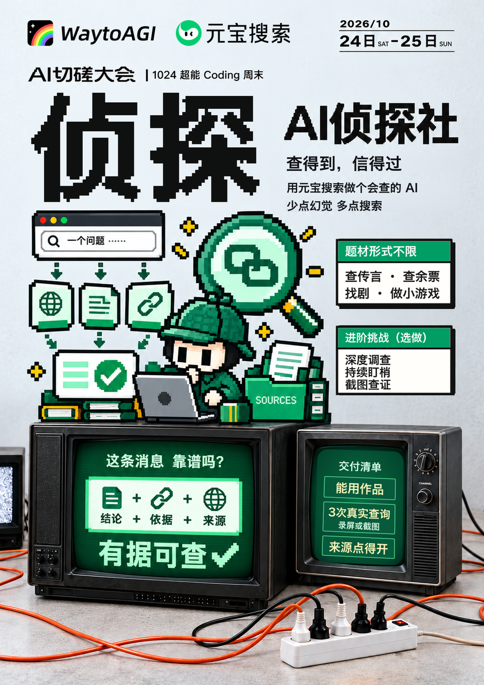
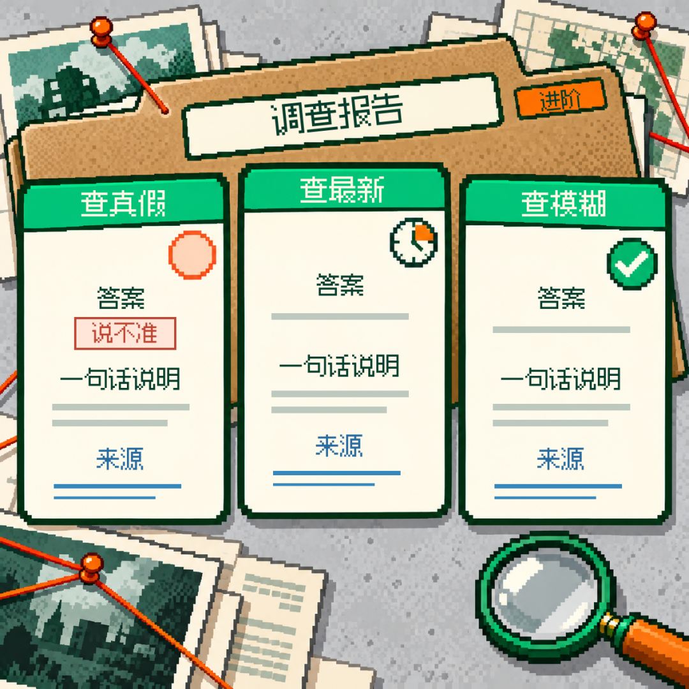
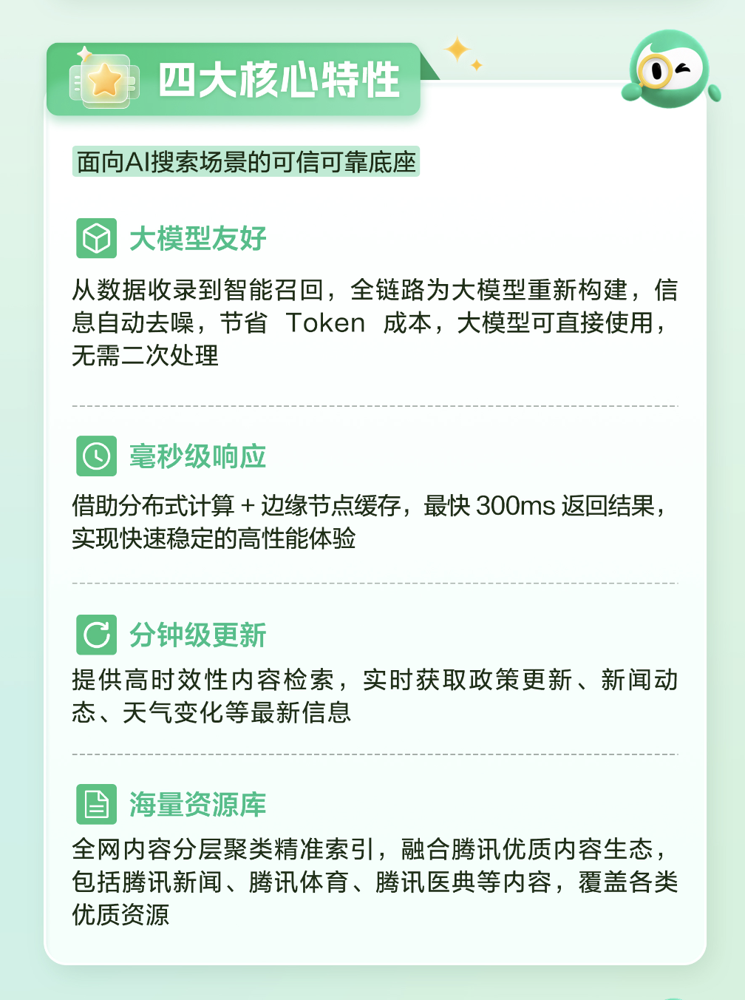
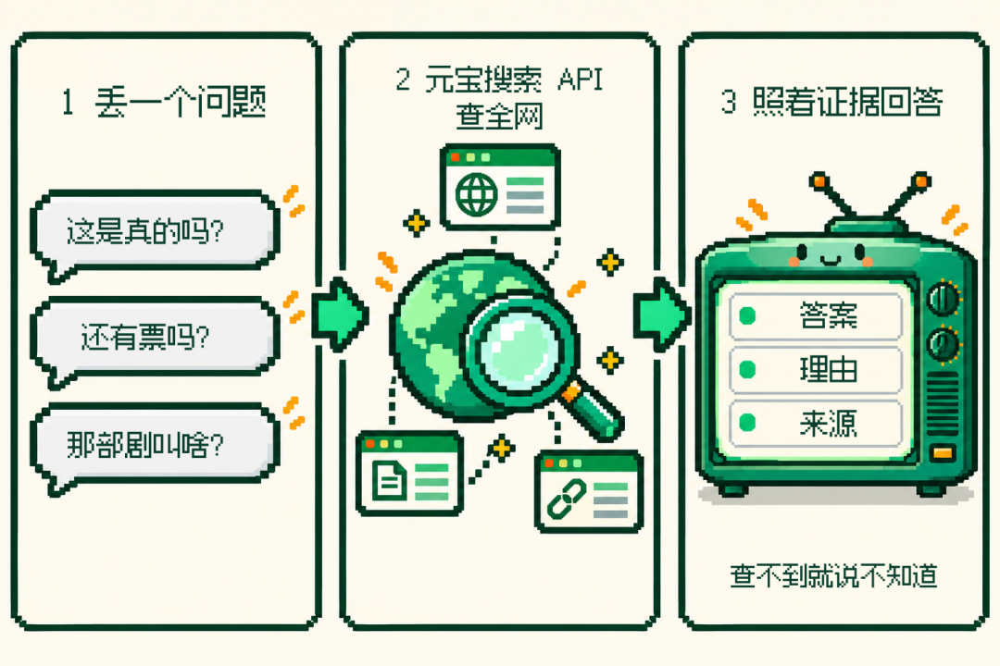
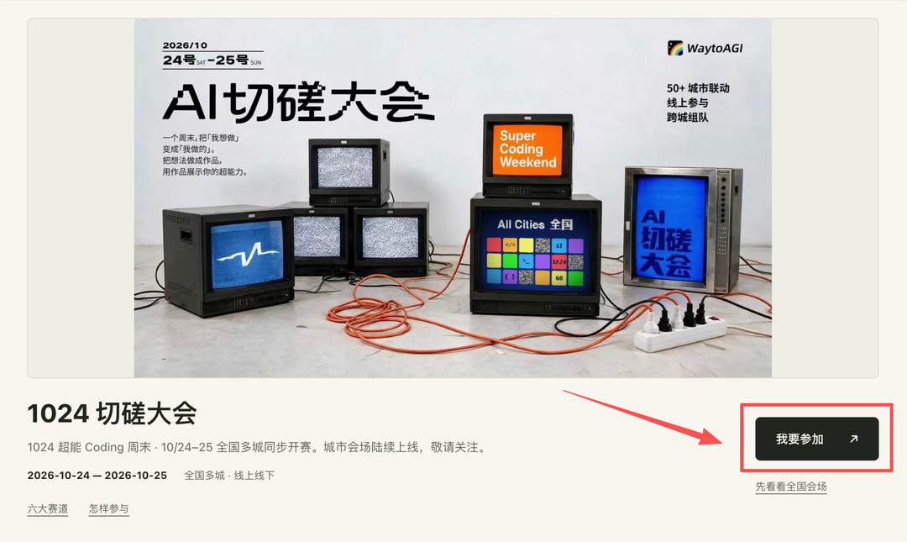

# 这周末用元宝搜索做AI侦探，冲MacBook、现金大奖！

来源：https://mp.weixin.qq.com/s/4i4hQB0oX3ED6PVwGwSC2w?scene=1

作者：WaytoAGI；公众号：通往AGI之路。发布时间：2026-10-20 16:22，页面标注浙江。

归档日期：2026-10-24（Asia/Shanghai）。正文和图片按原文顺序保存；换行经过整理，不改写措辞。图片文字另见《图片文字与核验记录》。

---

如果 AI 的每句回答都带出处，“抱歉，我之前说错了” 这句话，我们大概能少听一半。

你多半也被 AI 坑过。

问它楼下火锅店今天开不开，它说营业到晚上 10 点。下楼一看，卷帘门上贴着本店已搬迁。

问它「那个讲法医的女主剧」叫什么，它张口报了个剧名，你一搜，压根没有这部剧。

二姨在家族群转了一条《隔夜开水千万别喝》，你请它辟谣，它分析了三大段，结论是有一定道理。

前两回它都会说一句「抱歉，我之前说错了」。第三回它连抱歉都没说，因为它压根不知道自己错了。

AI 什么都好，就是说错说得太自信，认错认得太快。

大模型的知识有截止日期，碰上看到的新消息、记不太清的细节，就容易凭感觉补一个答案，这就是常说的幻觉。

治这个毛病，办法很朴素，那就是：先查，再说。查得到就亮出处，查不到就老实说不知道。

所以这次「1024超能Coding周末」，我们和元宝搜索一起开了一条新赛道：

🔍 侦探｜查得到，信得过

💰 并给大家准备了超丰厚奖品！

第一名：MacBook Air 13 英寸*1

第二名：iPhone 16 Pro*1

第三名：AirPods Pro*1

优秀奖：500 元京东 E 卡*10

01 这周末，来当一回 AI 侦探

先简单说下「1024超能Coding周末」。

10月24日-25日，WaytoAGI 全国 AI 切磋大会在近 40 座城市的线下会场和线上赛区同时开搓。

两天时间，每天 10:30 到 19:02，加起来正好 1024 分钟。

一共六条赛道：用餐、侦探、办公、短剧、OPC、游戏，随便挑，也可以多选。

侦探赛道的主题就是少点幻觉，多点搜索：用元宝搜索做一个会「查」的 AI 作品。

丢给它一个问题，它去搜索、比对，带着能点开的证据回来。

做什么、做成什么样都由你定，网页、机器人、Skill、应用、小游戏都行，只要搜索是它的核心。没想好的话，可以从下面三种「查」找灵感。

🔎 查真假

微波炉热过的饭会致癌？网红锅真的一个蛋都不粘？转发、下单之前，先让它查一遍，带上权威来源。

📰 查最新

今天发生了什么？演唱会还有没有票？让它从最新的公开信息里找，顺手标上查询时间和来源。

🧩 查模糊

只记得"那个谁演的剧"、想不起名字的老游戏，或者一句歌词？把这些零碎线索丢给它，它也能顺着搜出答案。

🚀 想挑战高难度？试试进阶

有余力的话，可以让它拆成几步做深度调查，也可以持续盯梢，有变化就提醒你，或者做截图查证，丢张群聊截图就能核对。这些都是选做，做到了评委会明显加分。

选题不限于这些。不过时政话题和具体某个人的私事先别碰，侦探也要讲职业操守。

交什么？

一个能打开的作品，再附 3 次真实查询的录屏或截图。

每次都要有查到的结果和点得开的来源链接。查真假的话，可以做成一张查证卡，写上结论是真、假还是说不准。做了进阶挑战的，再交一份调查报告、一次真实触发的提醒，或者截图查证的录屏。

评委看什么？

查得准不准，来源点不点得开，好不好玩。

想冲赛道前三，还要看两样：一是难度，问题够不够刁钻，会不会多步调查、交叉验证，来源互相打架时能不能讲清怎么判断；二是有没有人真在用。

评委还会特别看一点，查不到的时候，它敢不敢说"我不知道"。

在这条赛道，说不知道不扣分，瞎编才扣分。

02 侦探用什么查？元宝搜索

想让 AI 先查再说，它得有个靠谱的搜索引擎。

这次侦探赛道的合作工具，是元宝搜索。

元宝 App 的联网搜索就在用它，现在开发者在腾讯云上也能直接调用。

你的 AI 回答问题之前，它先去全网查一遍，把查到的内容连同出处一起交给 AI。

它把全网公开资源与腾讯内容生态接在一起，沉淀千亿索引，接入10+个垂直行业，覆盖157+个优质信源，涵盖腾讯新闻、腾讯体育、腾讯医典等腾讯生态及全网主流垂直领域资源。

支持分钟级内容更新，适合查询新闻、天气等时效性信息。具体答案仍要结合来源和更新时间判断。

官网标注最快 300 毫秒返回搜索结果；实际速度会随请求和网络情况变化。

搜索结果会自动去噪，便于大模型直接使用，也能节省 Token。把检索结果、来源链接和回答约束接起来，能帮助减少幻觉。

光说这些有点干，看个腾讯视频的例子。

腾讯视频接入元宝搜索后，补上了实时外网信源，也增强了对复杂描述的理解与信息召回。

「那个讲法医的女主剧」这样的模糊描述，就可以作为你的创作题目：提取线索、发起搜索，再把候选答案和出处摆出来。

这不就是我们跟朋友描述一部剧的样子吗？"就那个，那个谁演的，里面有个……"

让 AI 听懂线索，还能把找到的依据讲明白。

WorkBuddy、ima、腾讯视频、腾讯金融科技等都已接入。按腾讯云官网案例，ima 的信源召回提升了 10%，腾讯金融科技用一周搭建起金融搜索能力。

这么多腾讯产品在用的搜索，这个周末你也能拿来做侦探。

03 3 步，搭一个 AI 侦探

第一步：开通元宝搜索

前往元宝搜索官网：https://cloud.tencent.com/product/wsa

按接入指南开通服务：https://cloud.tencent.com/document/product/1806/121802

即日起至11月30日活动期间，凭邀请码成功核销后，每个账号每月可享 6000次免费调用额度。活动结束后，免费额度恢复至每月2000次。

具体版本开通条件及免费额度使用规则，请以腾讯云官方活动规则及控制台显示为准。

完成开通，这个周末就能拿真实问题反复打磨作品。

第二步：先让它去查

用户丢来一句话，先交给元宝搜索，拿回一组带链接的搜索结果。

第三步：让模型照着证据回答

把搜索结果交给大模型，提示词里把规矩讲清楚，比如这样写。

💡只根据下面的搜索结果回答。先给答案，再用一句话说明理由，每个关键说法后面标上来源链接。查真假时，结论用“真、假或说不准”。搜索结果里找不到依据的，直接回答“没查到可靠来源”，不要猜。

这样，一个会查证、会亮出处、查不到就认怂的 AI 侦探，就有雏形了。

剩下的交给你的脑洞，做成网页、聊天机器人、浏览器插件，或者一个能和朋友对战的真假新闻小游戏，都行。

04 奖励和参赛信息

🏆 侦探赛道奖励

赛道前三就是侦探赛道之星，现金正好是 1024 的 3 倍、2 倍、1 倍，元宝搜索再各加一份实物大奖。

•  第一名：3072 元现金＋MacBook Air 13 英寸 M4／512GB 1 台

•  第二名：2048 元现金＋iPhone 16 Pro 256GB 1 部

•  第三名：1024 元现金＋AirPods Pro（第二代）1 个

•  优秀奖 10 名：每名 500 元京东 E 卡实体卡 1 张

用元宝搜索做的作品，才评侦探赛道前三；用别的工具做的，照样能冲本地前三、人气奖和 1024 超能大奖（奖金 10240 元）。

10月24日全国连线开幕，元宝搜索的同学会在线上支持大家；11月1日全国颁奖直播，元宝搜索的评委也会来点评侦探赛道的作品。

⏰ 时间：10.24-25 10:30-19:02

📍 地点：近 40 座城市的线下会场和线上赛区，地址见活动官网

下图扫码，立即报名！

扫码报名 1024 超能 Coding 周末

👇🏻 报名流程：

1. 扫码进入活动页

2. 选择省份、城市、会场

3. 填写报名信息，提交报名

4. 扫码进本地群，算力/会员领取方式都会在群里通知

5. 活动开始前，到达活动现场参与即可

用 AI 这些年，我们听过太多次"抱歉，我之前说错了"。

这个周末，做一个先查再说、说了就有出处的 AI 吧。

下次再有人拿着一条拿不准的消息来问，稳稳接住的，就是你做的那个侦探。

10月24日，AI 切磋大会见！

💬 你被 AI 一本正经地胡说八道坑过吗？评论区说说，说不定就是侦探赛道的第一道考题～

👀 近期看点

总奖池400+万！还有MacBook、iPhone大奖，1024超能Coding周末赞助揭晓

最高10240元！AI切磋大会报名开启，6大赛道等你来Coding

硅谷AI一线见闻：AIE大会有哪些好玩的？

我们开源了50个社区高手的Skill，在云栖大会摆了一面墙

---

## 原文链接清单

- 1024超能Coding周末：https://mp.weixin.qq.com/s?__biz=MzkzMzQ5MDA5Ng==&mid=2247509962&idx=1&sn=239a8d4224bd23d6d76e9810495b171d&scene=21#wechat_redirect
- 总奖池400+万！还有MacBook、iPhone大奖，1024超能Coding周末赞助揭晓：https://mp.weixin.qq.com/s?__biz=MzkzMzQ5MDA5Ng==&mid=2247509962&idx=1&sn=239a8d4224bd23d6d76e9810495b171d&scene=21#wechat_redirect
- 最高10240元！AI切磋大会报名开启，6大赛道等你来Coding：https://mp.weixin.qq.com/s?__biz=MzkzMzQ5MDA5Ng==&mid=2247509755&idx=1&sn=37e8b5d65513689309e07f34b55ba8f2&scene=21#wechat_redirect
- 硅谷AI一线见闻：AIE大会有哪些好玩的？：https://mp.weixin.qq.com/s?__biz=MzkzMzQ5MDA5Ng==&mid=2247509901&idx=1&sn=e34c1c0f46ff8dc49cb98ad5b48bb8f2&scene=21#wechat_redirect
- 我们开源了50个社区高手的Skill，在云栖大会摆了一面墙：https://mp.weixin.qq.com/s?__biz=MzkzMzQ5MDA5Ng==&mid=2247509870&idx=1&sn=bd157a0e4622fbd3d15cf5a322036fde&scene=21#wechat_redirect